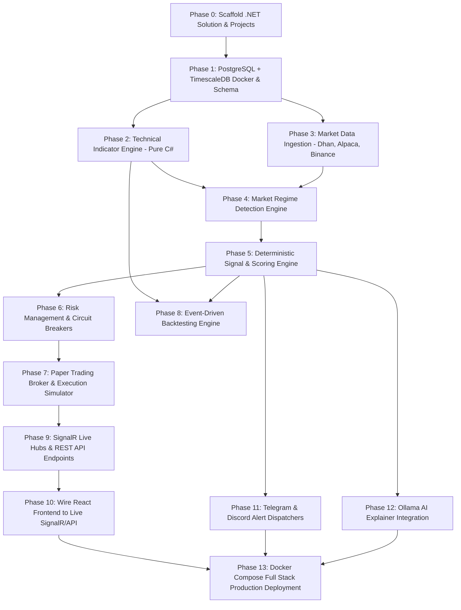

# ProStock: Complete Project Completion Roadmap & Master Execution Plan

> **Document Type:** Master Architectural Gap Analysis, Technical Roadmap & Build Checklist  
> **Target Audience:** Engineering Team / System Architect  
> **Workspace Root:** `c:\Users\prakathishwaran.mani\OneDrive - psiog.com\Desktop\ProStock\`  
> **Reference Specs:** [`PROSTOCK_MASTER_SPECIFICATION_v2.md`](file:///c:/Users/prakathishwaran.mani/OneDrive%20-%20psiog.com/Desktop/ProStock/PROSTOCK_MASTER_SPECIFICATION_v2.md), [`PROSTOCK_PROJECT_GUIDE.md`](file:///c:/Users/prakathishwaran.mani/OneDrive%20-%20psiog.com/Desktop/ProStock/PROSTOCK_PROJECT_GUIDE.md)  
> **Date:** October 2026  
> **Status:** Active Roadmap  

---

## Table of Contents

1. [Executive Summary: Current State vs. Full Vision](#1-executive-summary-current-state-vs-full-vision)
2. [What Has Been Completed (Current Inventory)](#2-what-has-been-completed-current-inventory)
3. [Deep-Dive: What Remains to Complete the Entire Project](#3-deep-dive-what-remains-to-complete-the-entire-project)
   - [3.1 Backend Architecture (.NET 9 / 10 Clean Architecture)](#31-backend-architecture-net-9--10-clean-architecture)
   - [3.2 Database Layer (PostgreSQL 16 + TimescaleDB Extension)](#32-database-layer-postgresql-16--timescaledb-extension)
   - [3.3 Market Data Ingestion & Streaming Pipeline (Engine 1)](#33-market-data-ingestion--streaming-pipeline-engine-1)
   - [3.4 Technical Indicator Engine (Engine 2)](#34-technical-indicator-engine-engine-2)
   - [3.5 Market Regime Detection Engine (Engine 3)](#35-market-regime-detection-engine-engine-3)
   - [3.6 Deterministic Signal & Scoring Engine (Engine 4)](#36-deterministic-signal--scoring-engine-engine-4)
   - [3.7 Risk Management & Circuit Breaker Engine (Engine 5)](#37-risk-management--circuit-breaker-engine-engine-5)
   - [3.8 Paper Trading & Realistic Execution Broker (Engine 6)](#38-paper-trading--realistic-execution-broker-engine-6)
   - [3.9 Event-Driven Backtesting Engine (Engine 7)](#39-event-driven-backtesting-engine-engine-7)
   - [3.10 Real-Time API & SignalR Streaming Hubs](#310-real-time-api--signalr-streaming-hubs)
   - [3.11 AI / LLM Contextual Explainer Engine (Ollama / Local DeepSeek)](#311-ai--llm-contextual-explainer-engine-ollama--local-deepseek)
   - [3.12 Alerting & Notification Dispatcher (Telegram & Discord)](#312-alerting--notification-dispatcher-telegram--discord)
   - [3.13 Frontend Live Connection & Enhancements](#313-frontend-live-connection--enhancements)
   - [3.14 Authentication, Security & Secret Management](#314-authentication-security--secret-management)
   - [3.15 DevOps, Docker Orchestration, Health Monitoring & CI/CD](#315-devops-docker-orchestration-health-monitoring--cicd)
4. [Master Implementation Sequence & Dependency Graph](#4-master-implementation-sequence--dependency-graph)
5. [Complete Master Checklist (Checkboxes for Tracking)](#5-complete-master-checklist-checkboxes-for-tracking)

---

## 1. Executive Summary: Current State vs. Full Vision

ProStock is an **autonomous, 24/7 institutional-grade algorithmic market scanner, paper execution broker, and quantitative backtesting system** covering Indian Equities (NSE/BSE), MCX Commodities, US Markets (NYSE/NASDAQ), and Cryptocurrencies (Binance).

```
┌────────────────────────────────────────────────────────────────────────────────────────┐
│                                  PROSTOCK ARCHITECTURE MATRIX                          │
├────────────────────────────────┬────────────────────────────────┬─────────────────────┤
│ SUBSYSTEM                      │ CURRENT STATUS                 │ EFFORT REMAINING    │
├────────────────────────────────┼────────────────────────────────┼─────────────────────┤
│ 1. Frontend Web Cockpit        │ 90% Complete (Mock Mode)       │ 10% (Live Wiring)   │
│ 2. Backend Solution (.NET)     │ 0% (Not scaffolded)            │ 100% (Full Build)   │
│ 3. Database (TimescaleDB)      │ 0% (Not deployed)              │ 100% (Full Build)   │
│ 4. Data Ingestion (Brokers)    │ 0% (Mock JSON only)            │ 100% (Full Build)   │
│ 5. Indicator & Regime Math     │ 0% (Client canvas EMA only)    │ 100% (C# Core)      │
│ 6. Signal & Factor Scoring     │ 0% (Mock JSON data only)       │ 100% (C# Core)      │
│ 7. Risk & Paper Execution      │ 0% (Frontend state only)       │ 100% (C# Core)      │
│ 8. Backtesting Simulator       │ 0% (UI forms only)             │ 100% (C# Core)      │
│ 9. SignalR Live Broadcast      │ 0% (Not wired)                 │ 100% (Full Build)   │
│ 10. AI News & Trade Explainer  │ 0% (Mock summaries only)       │ 100% (Ollama/API)   │
│ 11. Alerts (Telegram/Discord)  │ 0% (Not connected)             │ 100% (Full Build)   │
│ 12. Docker & DevOps            │ 0% (No Dockerfile/Compose)     │ 100% (Full Build)   │
└────────────────────────────────┴────────────────────────────────┴─────────────────────┘
```

The system currently has an **exhaustive, verified React 19 Frontend Web Terminal** running in browser with mock data and zero build errors. However, **the entire backend engine, database, real-time streaming pipeline, and ingestion feeds remain to be created from scratch**.

---

## 2. What Has Been Completed (Current Inventory)

The following components are fully built, tested, and operational in `web/`:

1. **Frontend Architecture & Scaffolding:**
   - React 19 + TypeScript + Vite + Tailwind CSS v3 dark theme design tokens (`bg-0` to `bg-3`, `accent`, `up`, `down`).
   - Production bundle verified with `npx tsc --noEmit` (0 errors) and `npx vite build` (100% clean bundle).
   - Hot-reload development server running on port 3000.
2. **17 Cockpit Views (§13.4 Master Spec):**
   - `CockpitDashboard`: Main mission-control matrix (Ticker tape, candlestick chart, market breadth, portfolio heat bar, verified signals matrix).
   - `MarketsPage`: Multi-exchange overview (NSE, BSE, MCX, US, Crypto).
   - `WatchlistsPage`: Filterable real-time ticker tables with regime badges and RVOL metrics.
   - `SignalsPage`: Real-time signal screener with direction filters, strategy tabs, and score indicators.
   - `DeepDivePage`: Single-instrument fundamental, technical, and factor inspection.
   - `ChartStudioPage`: Multi-timeframe charting workspace.
   - `MarketReplayPage`: Bar-by-bar playback controls (Play, Pause, Speed 1x–10x, scrubber).
   - `BacktestingPage`: Parameter builder (Date ranges, capital, slippage, stop types) and equity curve metrics.
   - `StrategiesPage`: Strategy registry, performance stats, and state toggles (Active, Shadow, Draft, Retired).
   - `PaperTradingPage`: Position tables, order book, and real-time PnL tracker.
   - `PortfolioPage`: Portfolio heat, sector allocation, and drawdown metrics.
   - `TradeJournalPage`: Trade logs, execution tags, and performance breakdown.
   - `RiskConsolePage`: Real-time circuit breaker status, max drawdown limits, and margin thresholds.
   - `NewsPage`: Macro and instrument-specific news feed with sentiment tagging.
   - `CalendarPage`: Economic events calendar with high-volatility blackout flags.
   - `SystemHealthPage`: Feed latencies, aggregation lag, database write speeds, and CPU/memory metrics.
   - `SettingsPage`: API key vault, alert channels (Telegram/Discord), and trading presets.
3. **Interactive Components & Global Modals:**
   - `InteractiveChart`: High-DPI canvas candlestick chart with Volume bars, VWAP, EMA-20, SL/TP overlays, and crosshair tooltip.
   - `SignalDetailDrawer`: 9-section inspect drawer (§13.6) displaying trade plan, score waterfall, rule verification, invalidation criteria, and historical win-rate evidence.
   - `OrderTicketModal`: Live risk calculator with position sizing, margin validation, and bracket order setup.
   - `CommandPalette`: Keyboard-navigable quick switcher (`Ctrl+K`).
   - `TopNav`, `Sidebar`, `StatusBar`: Dense financial terminal layout with live telemetry pills.
   - `ErrorBoundary`: Crash isolation wrapper preventing white-screen terminal crashes.
4. **Mock API Gateway Layer:**
   - Decoupled `src/api/client.ts` with `USE_MOCK_DATA = true` toggle pointing to structured JSON fixtures matching C# backend DTOs.

---

## 3. Deep-Dive: What Remains to Complete the Entire Project

Below is the complete, granular breakdown of every single file, class, database table, engine algorithm, and configuration required to finish ProStock.

---

### 3.1 Backend Architecture (.NET 9 / 10 Clean Architecture)

The backend must be built using ASP.NET Core (.NET 9 or 10 LTS) utilizing Microsoft's recommended Clean Architecture pattern.

```
c:\Users\prakathishwaran.mani\OneDrive - psiog.com\Desktop\ProStock\
├── ProStock.sln
├── src/
│   ├── ProStock.Domain/          # Core Domain Entities, Enums, Value Objects, Domain Events
│   ├── ProStock.Application/     # CQRS Commands/Queries, Engine Interfaces, DTOs, Validators
│   ├── ProStock.Infrastructure/  # EF Core, TimescaleDB, Dapper, Broker Adapters, Redis, Serilog
│   └── ProStock.Api/             # ASP.NET Core Web API, SignalR Hubs, Background Services
└── tests/
    ├── ProStock.UnitTests/       # Mathematical accuracy tests, indicator tests, rule tests
    └── ProStock.IntegrationTests/# Database tests, broker mock tests, API endpoint tests
```

#### Files & Components to Create:
1. **`ProStock.sln`**: Visual Studio / .NET CLI solution file binding all projects.
2. **`ProStock.Domain`**:
   - `Entities/`: `Instrument`, `Candle`, `Tick`, `Signal`, `Strategy`, `PaperAccount`, `PaperOrder`, `PaperPosition`, `PaperTrade`, `BacktestRun`, `AlertRule`, `SystemHealthSnapshot`.
   - `Enums/`: `MarketExchange` (NSE, BSE, MCX, NYSE, NASDAQ, Binance), `AssetClass`, `OrderSide`, `OrderType`, `OrderStatus`, `MarketRegime`, `SignalDirection`, `SignalStatus`, `SignalMode` (Live, Shadow), `StrategyState`.
   - `ValueObjects/`: `Price`, `Money`, `Quantity`, `TradePlan`, `FactorScore`, `RiskRewardRatio`.
   - `Exceptions/`: `RiskCircuitBreakerException`, `StaleFeedException`, `InsufficientMarginException`, `InvalidOrderException`.
3. **`ProStock.Application`**:
   - `Interfaces/Engines/`: `IMarketDataIngestionEngine`, `ITechnicalIndicatorEngine`, `IRegimeDetectionEngine`, `ISignalEngine`, `IRiskEngine`, `IPaperBroker`, `IBacktestEngine`.
   - `Interfaces/Repositories/`: `IInstrumentRepository`, `ICandleRepository`, `ISignalRepository`, `IPaperAccountRepository`, `IBacktestRepository`.
   - `Interfaces/Services/`: `IAlertDispatcher`, `ILLMExplainerService`, `ICacheService`.
   - `DTOs/`: 40+ request/response contracts matching frontend types.
   - `Behaviors/`: Validation pipeline (`FluentValidation`), logging pipeline, performance stopwatch.
4. **`ProStock.Infrastructure`**:
   - `Persistence/`: `ProStockDbContext` (EF Core 9/10), Dapper bulk inserters for high-frequency tick ingestion, TimescaleDB hypertable configuration.
   - `Adapters/Brokers/`:
     - `Dhan/`: `DhanHqFeedClient` (WebSocket + REST v2), `DhanTokenRefresher`.
     - `Alpaca/`: `AlpacaMarketFeedClient` (WebSocket + IEX REST).
     - `Binance/`: `BinanceKlineWebSocketClient`.
   - `Adapters/Alerts/`: `TelegramBotService`, `DiscordWebhookService`.
   - `Adapters/LLM/`: `OllamaDeepSeekClient` (local REST API integration).
   - `Caching/`: Redis distributed cache or `MemoryCache` implementation for hot ticker lookups.
5. **`ProStock.Api`**:
   - `Controllers/`: `MarketController`, `SignalsController`, `StrategiesController`, `PaperTradingController`, `BacktestController`, `HealthController`, `SettingsController`, `NewsController`.
   - `Hubs/`: `MarketHub` (`/hubs/market` for live ticks), `SignalHub` (`/hubs/signals` for real-time trade signals).
   - `BackgroundServices/`:
     - `MarketIngestionWorker`: Continuous hosted service managing WebSocket feed connections and auto-reconnecting on disconnect.
     - `CandleAggregationWorker`: In-memory multi-timeframe candle builder (1s, 1m, 5m, 15m, 1h, 1D).
     - `SignalScannerWorker`: Evaluates strategy rules on each candle close.
     - `DailyTokenWatchdogWorker`: Checks DhanHQ access token expiry and alerts the user.

---

### 3.2 Database Layer (PostgreSQL 16 + TimescaleDB Extension)

High-frequency market ticks and 1-minute candles will generate tens of millions of rows. Standard relational PostgreSQL will experience query degradation without TimescaleDB hypertables.

#### What Must Be Implemented:
1. **`docker-compose.yml`**:
   - `timescale/timescaledb:latest-pg16` service definition.
   - `redis:alpine` service for in-memory pub/sub and hot state caching.
   - Volume mounts for persistent storage (`/var/lib/postgresql/data`).
2. **Schema & 22+ Tables (SQL Migrations)**:
   - `instruments`: Master list of tradable symbols, exchange, tick size, lot size, trading hours, and status.
   - `market_candles`: **TimescaleDB hypertable** partitioned by `timestamp` (1-day chunk intervals). Columns: `time`, `symbol`, `timeframe`, `open`, `high`, `low`, `close`, `volume`, `vwap`.
   - `market_ticks`: **TimescaleDB hypertable** partitioned by `timestamp` (2-hour chunk intervals). Columns: `time`, `symbol`, `price`, `volume`, `side`.
   - `market_regimes`: History of detected market regimes per instrument and timeframe.
   - `strategy_definitions`: Strategy code, parameter definitions, versioning, author, and status.
   - `signals`: Complete signal records including setup score, entry zone, SL, targets, strategy ID, and immutable hash.
   - `signal_reasons`: Detailed checklist conditions passed or failed for each signal.
   - `signal_invalidations`: Void conditions monitored by background scanner.
   - `paper_accounts`: Virtual capital, currency, margin used/available, realized/unrealized PnL.
   - `paper_orders`: Order side, quantity, limit/market price, filled status, slippage applied, execution time.
   - `paper_positions`: Active positions, average entry price, unrealized PnL, R-multiple, active SL/TP.
   - `paper_trades`: Realized round-trip trade executions with net PnL, STT, brokerage, and holding time.
   - `paper_ledger`: Immutable financial ledger tracking all credit/debit adjustments.
   - `backtest_runs`: Metadata of executed backtests (strategy, time period, initial capital, metrics).
   - `backtest_trades`: Individual simulated trades generated during backtests.
   - `news_articles`: Macro and stock headlines, sentiment tags, AI summary, and affected symbols.
   - `calendar_events`: Economic calendar items, volatility impact, and trading blackout periods.
   - `alert_rules`: Configuration for notification triggers and target channels.
   - `alert_dispatches`: Log of dispatched notifications (status, timestamp, response).
   - `system_health_snapshots`: Latency metrics, aggregation lag, dropped ticks, and CPU load history.
   - `circuit_breaker_events`: Audit trail of risk halts, daily loss triggers, and feed stale incidents.
   - `user_audit_logs`: User settings changes and manual override actions.
3. **TimescaleDB Compression & Retention Policies**:
   - Enable TimescaleDB native columnar compression on `market_candles` for data older than 7 days:
     ```sql
     ALTER TABLE market_candles SET (timescaledb.compress, timescaledb.compress_segmentby = 'symbol, timeframe');
     SELECT add_compression_policy('market_candles', INTERVAL '7 days');
     ```
   - Auto-drop raw `market_ticks` older than 30 days to conserve SSD storage:
     ```sql
     SELECT add_retention_policy('market_ticks', INTERVAL '30 days');
     ```

---

### 3.3 Market Data Ingestion & Streaming Pipeline (Engine 1)

This engine is the sensory organ of ProStock. It must ingest real-time ticks, aggregate them into clean candles, and detect faulty or delayed feeds.

#### What Must Be Implemented:
1. **DhanHQ Adapter (`IDhanHqClient`)**:
   - Connection to DhanHQ Live Market Feed WebSocket.
   - Subscription management for NSE / BSE Equities and MCX Futures tokens.
   - Parsing binary packets (Packet 2, 4, 8) into standard `Tick` structs.
   - Daily access token renewal automation flow (§18.1 Master Spec).
2. **Alpaca Markets Adapter (`IAlpacaClient`)**:
   - Connection to Alpaca IEX Market Data WebSocket for US Stocks.
   - REST fallback for minute candle history backfilling.
3. **Binance Adapter (`IBinanceClient`)**:
   - Connection to Binance Combined Streams WebSocket (`btcusdt@kline_1m`, `ethusdt@kline_1m`, `solusdt@kline_1m`).
   - Parsing JSON kline ticks into standard domain `Candle` objects.
4. **In-Memory Multi-Timeframe Candle Aggregator**:
   - Thread-safe ring buffer (`Channel<Tick>` or `ConcurrentQueue`) processing incoming ticks.
   - Synthesizes 1-second, 1-minute, 5-minute, 15-minute, 1-hour, and 1-day candles.
   - Emits a `CandleClosedEvent` when a period completes, triggering signal evaluations.
5. **Feed Conflator & Heartbeat Watchdog**:
   - Measures tick arrival latency (local arrival timestamp minus broker timestamp).
   - Flags feeds as `STALE` if no tick arrives within 5 seconds during active market hours.
   - Trips the Stale Data Circuit Breaker to freeze signal generation when feeds are degraded.

---

### 3.4 Technical Indicator Engine (Engine 2)

Indicators must be computed in pure, high-performance, zero-allocation C# code without relying on external commercial black-box libraries.

#### What Must Be Implemented:
1. **Moving Averages:**
   - `SimpleMovingAverage (SMA)`: Configurable period (e.g., 20, 50, 200).
   - `ExponentialMovingAverage (EMA)`: Multiplier $k = \frac{2}{N + 1}$, incremental calculation on streaming ticks.
   - `HullMovingAverage (HMA)` and `WeightedMovingAverage (WMA)`.
2. **Oscillators & Momentum:**
   - `RelativeStrengthIndex (RSI)`: Wilder's smoothing method, configurable 14-period.
   - `MovingAverageConvergenceDivergence (MACD)`: Fast EMA (12), Slow EMA (26), Signal (9), Histogram.
   - `StochasticOscillator`: %K (14), %D (3).
3. **Volatility & Range:**
   - `AverageTrueRange (ATR)`: True Range = $\max(H-L, |H-C_{prev}|, |L-C_{prev}|)$, smoothed with RMA.
   - `BollingerBands (BB)`: Middle (SMA 20), Upper ($+2\sigma$), Lower ($-2\sigma$), Bandwidth, %B.
   - `KeltnerChannels`: EMA middle line with ATR envelope.
4. **Trend & Volume:**
   - `SuperTrend`: ATR-based trailing bands with trend flip state detection (Green/Red).
   - `VolumeWeightedAveragePrice (VWAP)`: Cumulative $(\text{Typical Price} \times \text{Volume}) / \text{Cumulative Volume}$, resetting at session start (e.g., 09:15 IST / 09:30 EST / 00:00 UTC).
   - `RelativeVolume (RVOL)`: Current volume compared to historical average volume for the same time-of-day.
5. **Streaming / Incremental Computation:**
   - Maintain running state in memory so computing indicators for a new bar takes $< 0.1$ microseconds instead of recalculating 10,000 bars from scratch.
   - Unit tests verifying exact match against standard TradingView / Ta-Lib reference outputs ($99.99\%$ numerical parity).

---

### 3.5 Market Regime Detection Engine (Engine 3)

Markets behave differently in bull trends, bear trends, and choppy consolidation. Strategies must only fire in their designated regime.

#### What Must Be Implemented:
1. **Regime Classifier State Machine**:
   - Evaluates:
     - ADX (Average Directional Index) > 25 indicates strong trend; < 20 indicates ranging/choppy.
     - Price vs. EMA 20 vs. EMA 50 alignment and slope.
     - Bollinger Bandwidth percentiles (compression vs. expansion).
     - ATR expansion/compression ratio.
2. **5 Canonical Regimes (§6 Master Spec)**:
   - `TRENDING_BULL`: ADX > 25, Price > EMA20 > EMA50, positive slope.
   - `TRENDING_BEAR`: ADX > 25, Price < EMA20 < EMA50, negative slope.
   - `RANGING`: ADX < 20, Bollinger Bands flat, price oscillating around VWAP.
   - `VOLATILITY_EXPANSION`: ATR > 1.5x 20-period ATR average, Bollinger Band breakout.
   - `VOLATILITY_COMPRESSION`: Squeeze condition, low ATR, inside bar series.
3. **Regime Persistence & History**:
   - Stores historical regime changes in `market_regimes` table.
   - Serves regime classification via API to the frontend `RegimeBadge` and filter widgets.

---

### 3.6 Deterministic Signal & Scoring Engine (Engine 4)

This is the core decision engine. It evaluates trade strategies against closed candles, computes setup scores, generates precise trade plans, and enforces strict gates.

#### What Must Be Implemented:
1. **Strategy Registry & Specification Interface (`ITradingStrategy`)**:
   - Name, version, description, supported timeframes, allowed regimes.
   - `Evaluate(StrategyContext context) -> SignalResult`.
2. **Built-In Standard Strategies (§7 Master Spec)**:
   - `TrendPullbackVWAP`: Long in `TRENDING_BULL` on pullback to VWAP + RSI oversold hook.
   - `BreakoutVolumeConfirmation`: Breakout above 20-candle resistance with RVOL > 2.0x and ATR expansion.
   - `MeanReversionBandBounce`: Reversal in `RANGING` regime when price pierces lower Bollinger Band + bullish divergence.
   - `SuperTrendRegimeContinuation`: Trend continuation following 15m SuperTrend flip confirmed by 1D trend.
3. **Setup Scoring Waterfall (0 to 100 Scale)**:
   - Factor 1: Trend & Regime Alignment (Weight: 25 points).
   - Factor 2: Momentum & Indicator Confluence (Weight: 20 points).
   - Factor 3: Volume Confirmation & RVOL (Weight: 20 points).
   - Factor 4: Volatility & ATR Room (Weight: 15 points).
   - Factor 5: S/R & VWAP Proximity (Weight: 20 points).
   - Normalized 0–100 total score.
4. **Hard Elimination Gates (All Must Pass)**:
   - Gate 1: Regime Match (Strategy must be permitted in current regime).
   - Gate 2: Minimum Risk-to-Reward ratio $\ge 1.5:1$.
   - Gate 3: Relative Volume $\ge 1.0\text{x}$.
   - Gate 4: Volatility Gate (Spread / ATR ratio within safe limits).
   - Gate 5: Economic Calendar Blackout (No trades within 15 minutes of major rate/inflation release).
5. **Trade Plan Generator**:
   - `EntryZone`: `[entryMin, entryMax]` based on tick boundaries.
   - `StopLoss`: Placed behind structural pivot or $1.5 \times \text{ATR}$.
   - `Target1`: Set at $1.5\text{R}$ (minimum).
   - `Target2`: Set at $2.5\text{R}$ (runner).
   - `SuggestedQuantity`: Computed dynamically using the $1\%$ portfolio risk rule:
     $$\text{Quantity} = \left\lfloor \frac{\text{Account Capital} \times \text{Risk \%}}{|\text{Entry} - \text{StopLoss}|} \right\rfloor$$
6. **Invalidation Monitor ("Void Setup If...")**:
   - Defines exact boundary rules (e.g., "Cancel signal if price closes below ₹2,480 before entry is triggered").
   - Auto-expires pending signals that are not filled within $N$ candles.
7. **Anti-Repainting Guarantee**:
   - Signals are generated strictly on confirmed candle closes or deterministic tick events.
   - Each signal receives a SHA-256 fingerprint; once saved to the database, its parameters are immutable.

---

### 3.7 Risk Management & Circuit Breaker Engine (Engine 5)

Ensures capital preservation by stopping bad trades before they hit the market and killing the system if daily losses exceed safety thresholds.

#### What Must Be Implemented:
1. **Pre-Trade Risk Validator**:
   - Rejects any order exceeding $2\%$ maximum capital risk on a single trade.
   - Validates that total portfolio heat (sum of open trade risks) does not exceed $40\%$.
   - Rejects trade if available margin is insufficient.
2. **Sector & Correlated Exposure Limits**:
   - Maximum 2 active positions within the same sector (e.g., maximum 2 in Banking, 2 in IT).
   - Prevents concentrated directional exposure during sector sell-offs.
3. **Daily Loss Circuit Breaker (The "Kill Switch")**:
   - Monitors daily realized + unrealized drawdown.
   - If daily loss reaches $3\%$ of total equity:
     - Instantly cancels all open pending orders.
     - Closes market-sensitive positions or halts further entries.
     - Locks trading state until 00:00 UTC / next market session.
     - Dispatches urgent critical alerts to Telegram and Discord.
4. **Stale Data Circuit Breaker**:
   - Halts trade execution if broker WebSocket latency exceeds $3,000\text{ ms}$.

---

### 3.8 Paper Trading & Realistic Execution Broker (Engine 6)

Simulates real broker behavior with realistic fills, order queue simulation, slippage, and real-world Indian / US / Crypto taxes and transaction fees.

#### What Must Be Implemented:
1. **Virtual Order Book Simulator**:
   - Supports `MARKET`, `LIMIT`, `STOP_LOSS`, `STOP_LIMIT`, and `BRACKET (OCO)` orders.
   - Validates fills against subsequent tick prices (limit buy only fills if market trades at or below limit price).
2. **Realistic Slippage Model**:
   - Base slippage: $0.02\%$ on liquid instruments.
   - Volatility multiplier: Slippage scales up during high ATR / high RVOL breakout candles.
3. **Fee & Tax Deduction Engine (§8.4 Master Spec)**:
   - **Indian Equities (NSE/BSE)**:
     - Securities Transaction Tax (STT): $0.1\%$ on buy & sell (delivery) or $0.025\%$ on sell (intraday).
     - Exchange Turnover Charges: $0.00325\%$.
     - GST: $18\%$ on brokerage and turnover charges.
     - SEBI Turnover Charges + Stamp Duty: $0.0015\%$.
   - **US Equities**: SEC fee ($0.0000278 \times \text{Volume}$), FINRA TAF ($0.000166 / \text{share}$).
   - **Crypto**: $0.1\%$ maker/taker fee.
4. **Position & Ledger Management**:
   - Calculates real-time unrealized PnL using incoming tick updates.
   - Tracks R-multiples achieved ($+1.5\text{R}$, $+2.5\text{R}$, $-1.0\text{R}$).
   - Automated trailing stops: Moves stop loss to breakeven once Target 1 is hit.
   - Double-entry virtual cash ledger recording all equity adjustments.

---

### 3.9 Event-Driven Backtesting Engine (Engine 7)

Allows testing any strategy across years of historical 1-minute data with zero future-lookahead bias.

#### What Must Be Implemented:
1. **Historical Bar-by-Bar Simulator**:
   - Feeds historical candles sequentially to the strategy engine.
   - Orders triggered on bar $N$ can only be filled on bar $N+1$ open (strictly eliminating lookahead bias).
2. **Realistic Execution in Backtests**:
   - Applies the same slippage and commission models as the paper broker.
3. **Quantitative Metrics Calculator (§9 Master Spec)**:
   - Initial Capital, Final Equity, Net Profit, Absolute Return \%.
   - CAGR (Compound Annual Growth Rate).
   - Maximum Drawdown \% and Max Drawdown Duration (in days/hours).
   - Total Trades, Winning Trades, Losing Trades, Win Rate \%.
   - Profit Factor ($\frac{\text{Gross Profits}}{\text{Gross Losses}}$).
   - Sharpe Ratio ($R_f = 6\%$ Indian repo rate or US treasury yield).
   - Sortino Ratio (downside deviation penalizer).
   - Calmar Ratio ($\frac{\text{CAGR}}{\text{Max Drawdown}}$).
   - Mathematical Expectancy in R-multiples ($E = (P_w \times R_w) - (P_l \times R_l)$).
4. **Output Artifacts**:
   - Equity curve time series array (for chart rendering).
   - Monthly performance heatmap grid (Year $\times$ Month \% return).
   - Complete trade log with entry time, exit time, symbol, direction, PnL, and exit reason.

---

### 3.10 Real-Time API & SignalR Streaming Hubs

Connects the backend engines to the frontend web terminal via sub-second WebSocket pushes.

#### What Must Be Implemented:
1. **REST Endpoints (`/api/v1/...`)**:
   - `/markets/overview`: Indices, market breadth, sector heat map.
   - `/markets/tickers`: Filterable real-time ticker quotes.
   - `/markets/candles?symbol=...&tf=...`: Historical candle array for charts.
   - `/signals`: Active, expired, and historical signals.
   - `/signals/{id}`: Full 9-section inspect breakdown.
   - `/papertrading/account`: Cash balance, equity, heat %, margin.
   - `/papertrading/positions`: Open positions with real-time PnL.
   - `/papertrading/orders`: Working order book.
   - `/papertrading/order`: POST endpoint to execute manual paper orders.
   - `/backtest/run`: POST endpoint to launch backtest jobs.
   - `/backtest/results/{id}`: Fetch backtest performance metrics.
   - `/health`: System telemetry, feed latency, watchdog status.
2. **SignalR Hubs (`/hubs/...`)**:
   - `MarketHub` (`/hubs/market`): Broadcasts `TickUpdate`, `CandleUpdate`, `BreadthUpdate`.
   - `SignalHub` (`/hubs/signals`): Broadcasts `SignalCreated`, `SignalUpdated`, `SignalClosed`, `CircuitBreakerTripped`.
   - Client groups: Clients subscribe only to active symbols (e.g. `JoinSymbolGroup("RELIANCE")`) to prevent bandwidth exhaustion.

---

### 3.11 AI / LLM Contextual Explainer Engine (Ollama / Local DeepSeek)

Adheres strictly to Core Principle 2: **LLMs never generate trades or buy/sell decisions**. They only act as read-only contextual summarizers.

#### What Must Be Implemented:
1. **Ollama Integration Client (`OllamaClient.cs`)**:
   - Connects to local Ollama instance (`http://localhost:11434`) running `deepseek-r1:8b`, `llama3:8b`, or `mistral:7b`.
   - Fallback to OpenAI / Anthropic REST endpoints if API keys are provided in `Settings`.
2. **Deterministic Fact Extraction Prompt**:
   - Feeds the LLM structured JSON: current indicator values, active regime, checklist conditions passed, and recent news headlines.
   - Strict system prompt enforcing factual grounding (prohibiting speculation or advice).
3. **Structured Explainer Output**:
   - Generates the 3-bullet concise rationale displayed in `SignalDetailDrawer` and `CockpitDashboard`:
     - Summary sentence.
     - Grounding technical facts.
     - Potential risk factors.
4. **Asynchronous Non-Blocking Execution**:
   - Signal generation NEVER waits for the LLM. Signals fire instantly; the AI explanation is generated asynchronously and pushed via SignalR once completed.

---

### 3.12 Alerting & Notification Dispatcher (Telegram & Discord)

Delivers instant, actionable alerts to mobile devices and team channels within 1 second of signal generation.

#### What Must Be Implemented:
1. **Telegram Bot Dispatcher (`TelegramAlertService`)**:
   - Bot token configuration and chat ID target.
   - Rich Markdown formatting with emoji status icons:
     - 🟢 **LONG SIGNAL: RELIANCE (NSE)**
     - Strategy: VWAP Pullback v2.1
     - Entry Zone: ₹2,480.00 – ₹2,485.00
     - Stop Loss: ₹2,460.00 (Risk: ₹20.00)
     - Target 1: ₹2,510.00 (1.5R) | Target 2: ₹2,530.00 (2.5R)
     - Setup Score: **88/100** | Regime: Trending Bull
     - Inline buttons: `[Acknowledge]` `[Execute Paper Trade]` `[Mute 1h]`
2. **Discord Webhook Dispatcher (`DiscordAlertService`)**:
   - Formatted embed cards with color-coded side borders (Green for Long, Red for Short, Yellow for Warning).
3. **Notification Rate Limiter & Deduplication**:
   - Throttles alerts to avoid spamming (e.g., maximum 1 notification per symbol per 15 minutes).
   - User channel preferences (e.g. High-score signals $\ge 85$ to Telegram, all signals to Discord).

---

### 3.13 Frontend Live Connection & Enhancements

Connecting the existing React 19 UI to the live backend.

#### What Must Be Implemented:
1. **SignalR Frontend Client (`src/api/signalr.ts`)**:
   - Install `@microsoft/signalr`.
   - Implement persistent connection manager with exponential backoff auto-reconnect.
   - Wire `MarketContext.tsx` to update live prices on `TickUpdate`.
   - Wire toast notifications and `SignalsPage` on `SignalCreated`.
2. **Toggle Off Mock Data**:
   - In `src/api/client.ts`, set `USE_MOCK_DATA = false`.
   - Validate live HTTP REST endpoints against ASP.NET Core API.
3. **Client-Side URL Routing (React Router v6 / TanStack Router)**:
   - Add browser history and deep-linkable URLs:
     - `/cockpit` -> Cockpit Dashboard
     - `/signals/:id` -> Directly opens Signal Drawer
     - `/charts?symbol=NIFTY` -> Direct link to chart studio
     - `/backtest/:id` -> Historical backtest results
4. **Optional TradingView Lightweight Charts Integration**:
   - Integrate `lightweight-charts` v4 alongside the custom Canvas chart for advanced multi-indicator pane overlays (e.g., MACD / RSI sub-panels).

---

### 3.14 Authentication, Security & Secret Management

Protecting private financial API keys and managing user sessions.

#### What Must Be Implemented:
1. **JWT Authentication & Refresh Token Flow**:
   - User registration & login endpoints (`/api/v1/auth/login`, `/api/v1/auth/refresh`).
   - Secure HTTP-only cookies or Bearer token authorization header in frontend.
2. **AES-256 Encrypted Credential Vault**:
   - Broker API keys (DhanHQ Client ID, Alpaca Secret, Binance Key, Telegram Bot Token) encrypted at rest in the database using machine-specific master key.
   - Decrypted only in-memory when establishing feed connections.
3. **Rate Limiting & CORS Policies**:
   - ASP.NET Core rate limiting middleware on public API endpoints.
   - CORS policy restricted to the trusted frontend origin.

---

### 3.15 DevOps, Docker Orchestration, Health Monitoring & CI/CD

Deploying the complete platform for uninterrupted 24/7 autonomous execution.

#### What Must Be Implemented:
1. **Multi-Stage Dockerfiles**:
   - `backend.Dockerfile`: .NET 9 SDK build -> optimized Alpine/Debian runtime image.
   - `frontend.Dockerfile`: Node.js build -> lightweight NGINX Alpine image serving static files and reverse-proxying API/SignalR traffic.
2. **Production `docker-compose.prod.yml`**:
   - Services: `timescaledb`, `redis`, `prostock-api`, `prostock-worker`, `prostock-web`, `ollama`.
   - Health checks, resource constraints (CPU/RAM limits), and auto-restart policies (`restart: unless-stopped`).
3. **Observability & Health Monitoring**:
   - Serilog structured JSON logging with console and rotating file sinks (`logs/prostock-.json`).
   - Standard ASP.NET Core `/health/ready` and `/health/live` endpoints probing database connection, Redis, and WebSocket feed heartbeats.
4. **Automated Database Backup Routine**:
   - Nightly automated `pg_dump` script archiving TimescaleDB candles and trade logs to encrypted cloud/local backup.

---

## 4. Master Implementation Sequence & Dependency Graph

To build the remaining systems systematically without blocker cycles, follow this strict phase dependency order:



---

## 5. Complete Master Checklist (Checkboxes for Tracking)

Use this checklist to track development progress step-by-step:

### Phase 0: Project Setup & Architecture
- [ ] Create `ProStock.sln`
- [ ] Create `src/ProStock.Domain` class library
- [ ] Create `src/ProStock.Application` class library
- [ ] Create `src/ProStock.Infrastructure` class library
- [ ] Create `src/ProStock.Api` ASP.NET Core Web API project
- [ ] Create `tests/ProStock.UnitTests` xUnit project
- [ ] Create `tests/ProStock.IntegrationTests` xUnit project
- [ ] Configure project references, nullable types, and implicit usings
- [ ] Install NuGet packages (MediatR, FluentValidation, Serilog, EF Core, Dapper)
- [ ] Verify `dotnet build` succeeds with 0 errors

### Phase 1: Database & TimescaleDB
- [ ] Create root `docker-compose.yml` for PostgreSQL 16 + TimescaleDB + Redis
- [ ] Boot container and verify TimescaleDB extension is active
- [ ] Create `ProStockDbContext` with EF Core entity configurations
- [ ] Write SQL migration scripts for 22+ tables
- [ ] Configure `market_candles` hypertable (1-day chunk interval)
- [ ] Configure `market_ticks` hypertable (2-hour chunk interval)
- [ ] Add 7-day compression policy on `market_candles`
- [ ] Add 30-day retention policy on `market_ticks`
- [ ] Benchmark bulk insertion: 100,000 candles in $< 2$ seconds

### Phase 2: Technical Indicator Engine (Pure Math C#)
- [ ] Implement `SMA` (Simple Moving Average)
- [ ] Implement `EMA` (Exponential Moving Average, streaming incremental)
- [ ] Implement `RSI` (Wilder's Relative Strength Index)
- [ ] Implement `MACD` (Line, Signal, Histogram)
- [ ] Implement `ATR` (Average True Range)
- [ ] Implement `BollingerBands` (Upper, Middle, Lower, Bandwidth, %B)
- [ ] Implement `SuperTrend` with trend flip detection
- [ ] Implement `VWAP` with session boundary resets
- [ ] Implement `RVOL` (20-period relative volume)
- [ ] Write xUnit tests validating indicator accuracy against TradingView reference data ($99.99\%$ match)

### Phase 3: Market Data Ingestion Pipeline
- [ ] Implement `DhanHqFeedClient` (WebSocket + binary packet parsing)
- [ ] Implement `DhanTokenRefresher` (24h token renewal automation)
- [ ] Implement `AlpacaMarketFeedClient` (IEX WebSocket for US Equities)
- [ ] Implement `BinanceKlineWebSocketClient` (Crypto 1m streams)
- [ ] Build in-memory thread-safe `CandleAggregator` (1s, 1m, 5m, 15m, 1h, 1D)
- [ ] Implement feed heartbeat watchdog & stale detection ($> 5\text{s}$)
- [ ] Implement auto-reconnection with exponential backoff on network drop

### Phase 4: Market Regime Detection Engine
- [ ] Implement ADX calculation
- [ ] Implement EMA slope & alignment analyzer
- [ ] Implement Bollinger Bandwidth squeeze detector
- [ ] Build Regime State Machine (`TRENDING_BULL`, `TRENDING_BEAR`, `RANGING`, `VOLATILITY_EXPANSION`, `VOLATILITY_COMPRESSION`)
- [ ] Write tests verifying regime labels on historical bull, bear, and chop market data

### Phase 5: Deterministic Signal & Scoring Engine
- [ ] Implement `ITradingStrategy` interface
- [ ] Implement `TrendPullbackVWAP` strategy
- [ ] Implement `BreakoutVolumeConfirmation` strategy
- [ ] Implement `MeanReversionBandBounce` strategy
- [ ] Implement `SuperTrendRegimeContinuation` strategy
- [ ] Build 0–100 Setup Scoring waterfall (5 weighted factors)
- [ ] Build Hard Elimination Gates (Regime, 1.5R, RVOL, Volatility, Blackout)
- [ ] Build Trade Plan Generator (Entry zone, Stop Loss, TP1, TP2, position sizing)
- [ ] Build Invalidation Monitor rules
- [ ] Implement anti-repainting verification & SHA-256 immutable signal hashing

### Phase 6: Risk Management & Circuit Breakers
- [ ] Implement single-trade risk validator ($\le 2\%$)
- [ ] Implement total portfolio heat tracker ($\le 40\%$)
- [ ] Implement sector exposure limiter (max 2 positions per sector)
- [ ] Implement daily account drawdown circuit breaker (3% kill switch)
- [ ] Implement stale data trade halt ($\ge 3,000\text{ms}$ latency)
- [ ] Write unit tests verifying immediate trade rejection on risk breach

### Phase 7: Paper Trading Execution Broker
- [ ] Build virtual order book (`MARKET`, `LIMIT`, `STOP`, `BRACKET`)
- [ ] Implement tick-based fill simulation logic
- [ ] Implement dynamic slippage model ($0.02\%$ base + volatility multiplier)
- [ ] Implement transaction cost & tax deduction engine (Indian STT/GST, US SEC fees, Crypto fees)
- [ ] Build automatic trailing stop & partial-profit taker (50% at TP1 -> move SL to BE -> trail to TP2)
- [ ] Build virtual double-entry accounting ledger

### Phase 8: Event-Driven Backtesting Engine
- [ ] Build historical bar-by-bar simulator with zero lookahead bias
- [ ] Implement next-bar open execution logic
- [ ] Compute metrics: CAGR, Max Drawdown, Win Rate, Profit Factor
- [ ] Compute metrics: Sharpe Ratio, Sortino Ratio, Calmar Ratio, Expectancy R
- [ ] Generate equity curve time series and monthly return heatmap
- [ ] Benchmark: Backtest 2 years of Nifty 50 1-minute data in $< 30$ seconds

### Phase 9: ASP.NET Core Web API & SignalR Streaming
- [ ] Build REST controllers for markets, candles, signals, paper trading, strategies, and health
- [ ] Implement `MarketHub` SignalR hub for live tick & candle broadcasting
- [ ] Implement `SignalHub` SignalR hub for live signal alerts
- [ ] Configure symbol group subscriptions to optimize bandwidth
- [ ] Add Swagger / OpenAPI documentation
- [ ] Verify sub-second broadcast latency

### Phase 10: Wire Frontend to Live Backend
- [ ] Install `@microsoft/signalr` in `web/`
- [ ] Create persistent SignalR connection manager (`src/api/signalr.ts`)
- [ ] Connect `MarketContext` to live tick stream
- [ ] Connect `SignalsPage` and toasts to live signal push
- [ ] Set `USE_MOCK_DATA = false` in `src/api/client.ts`
- [ ] Implement React Router v6 for deep-linkable URLs (`/signals/:id`, etc.)
- [ ] Test end-to-end: Broker tick -> C# engine -> Signal generated -> React UI renders in $< 500\text{ ms}$

### Phase 11: Alerting & Notification Dispatcher
- [ ] Implement `TelegramAlertService` with formatted Markdown cards
- [ ] Implement `DiscordAlertService` with rich embed cards
- [ ] Add alert rate limiter (max 1 notification per symbol per 15m)
- [ ] Add user channel preferences configuration

### Phase 12: AI / LLM Contextual Explainer
- [ ] Setup local Ollama with `deepseek-r1:8b` or `llama3:8b`
- [ ] Build `OllamaClient.cs` calling Ollama REST API
- [ ] Implement deterministic prompt template feeding verified indicators and news
- [ ] Verify AI service runs non-blocking in background without delaying signal triggers

### Phase 13: Security, DevOps & Production Deployment
- [ ] Implement JWT authentication & refresh tokens
- [ ] Implement AES-256 encryption for broker API keys stored in database
- [ ] Write multi-stage `backend.Dockerfile` and `frontend.Dockerfile`
- [ ] Write `docker-compose.prod.yml` orchestrating the entire stack
- [ ] Configure Serilog structured JSON logging
- [ ] Configure `/health` endpoints and Docker health checks
- [ ] Set up automated nightly database backup script
- [ ] Execute 24-hour continuous burn-in test with zero memory leaks
