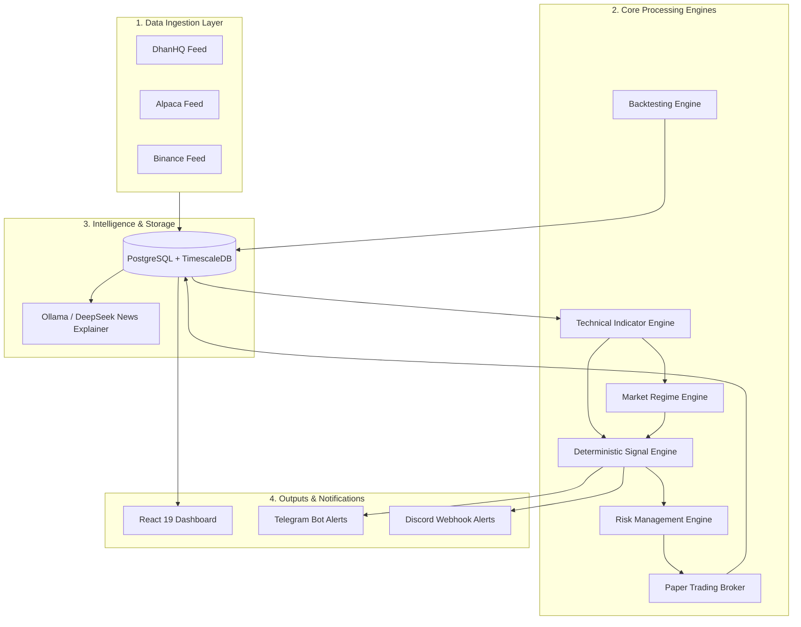
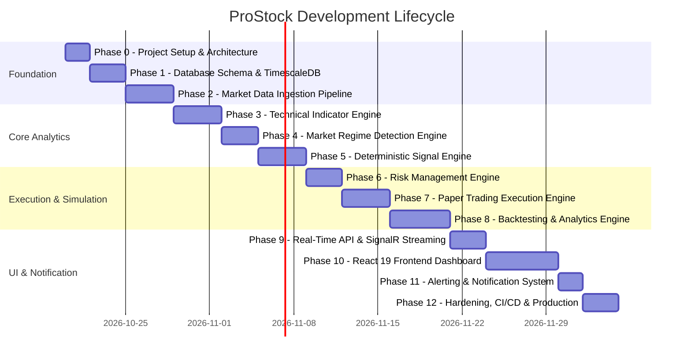

# ProStock: Complete Project & Implementation Guide

> **Document Type:** Master Project Onboarding, Architectural Reference & Build Roadmap  
> **Target Audience:** Project Owner / Lead Developer  
> **Workspace Directory:** `c:\Users\prakathishwaran.mani\OneDrive - psiog.com\Desktop\ProStock`  
> **Canonical Specification Reference:** [`PROSTOCK_MASTER_SPECIFICATION_v2.md`](file:///c:/Users/prakathishwaran.mani/OneDrive%20-%20psiog.com/Desktop/ProStock/PROSTOCK_MASTER_SPECIFICATION_v2.md)

---

## Table of Contents
1. [What is ProStock?](#1-what-is-prostock)
2. [Core Philosophy & Non-Negotiable Rules](#2-core-philosophy--non-negotiable-rules)
3. [What We Implement (The Engines & Systems)](#3-what-we-implement-the-engines--systems)
4. [What We Get (The Deliverables & Screens)](#4-what-we-get-the-deliverables--screens)
5. [Things to Know Before Using the App](#5-things-to-know-before-using-the-app)
6. [What We Can Do Right Now (Immediate Actions)](#6-what-we-can-do-right-now-immediate-actions)
7. [Step-by-Step Implementation Roadmap (Phases 0–12)](#7-step-by-step-implementation-roadmap-phases-012)
8. [Technology Stack Reference](#8-technology-stack-reference)

---

## 1. What is ProStock?

**ProStock** is an autonomous, private, 24/7 financial market analysis and paper trading platform. It is designed to operate continuously on a private server or local workstation, monitoring multiple asset classes across global timezones:

* **Indian Equities & Derivatives:** NSE / BSE, F&O via DhanHQ API
* **MCX Commodities:** Gold, Silver, Crude Oil, Natural Gas
* **US Equities:** NYSE / NASDAQ via Alpaca Markets API
* **Cryptocurrency:** Major pairs (BTC, ETH, SOL) via Binance API
* *(Future expansion)*: Global Forex (EUR/USD, GBP/USD, etc.)

Unlike retail chart websites or bot scams, ProStock is **not** a predictive black box. It is an algorithmic scanner, backtesting platform, and automated paper-execution engine that calculates verified mathematical setups, tracks market regimes, tests strategies against tick/candle history, and simulates realistic trading with slippage and commission models.

---

## 2. Core Philosophy & Non-Negotiable Rules

Before writing or running any code, the following foundational principles must be preserved across every layer:

```
┌────────────────────────────────────────────────────────────────────────┐
│                          PROSTOCK CORE PRINCIPLES                      │
├────────────────────────────────────────────────────────────────────────┤
│ 1. DETERMINISTIC SIGNALS ONLY                                          │
│    • Signals are generated purely by explicit mathematical logic.      │
│    • Machine Learning / LLMs NEVER generate buy/sell signals.          │
│                                                                        │
│ 2. AI / LLM IS STRICTLY AN EXPLAINER                                   │
│    • LLMs only read existing indicator outputs & summarize news.      │
│    • If an LLM API fails, the core trading/signal engine runs 100%.    │
│                                                                        │
│ 3. SETUP SCORE IS NOT A WIN PROBABILITY                                │
│    • A score of "85/100" means 85% of checklist conditions matched.    │
│    • It does NOT claim an 85% chance of profit.                        │
│                                                                        │
│ 4. PAPER TRADING FIRST                                                 │
│    • No real money execution until a strategy passes rigorous paper   │
│      forward testing across multiple market regimes.                   │
│                                                                        │
│ 5. STALE DATA CIRCUIT BREAKERS                                         │
│    • If feed timestamp is older than threshold (e.g. 5s for 1m bar),  │
│      signals are frozen. No trade on delayed data.                    │
│                                                                        │
│ 6. PLUGGABLE ARCHITECTURE                                              │
│    • Every broker, feed, and strategy implements a strict C# interface │
│    • Swapping DhanHQ for Zerodha, or Alpaca for Interactive Brokers    │
│      requires zero changes to the core engine.                         │
└────────────────────────────────────────────────────────────────────────┘
```

---

## 3. What We Implement (The Engines & Systems)

The project consists of 6 core backend engines, an ingestion layer, and an administrative notification system:



### Detailed Breakdown of Engines

| Engine | Responsibility & Features |
| :--- | :--- |
| **Technical Indicator Engine** | • Calculates 20+ indicators: EMA (9, 21, 50, 200), SMA, VWAP, SuperTrend, RSI (14), MACD, Bollinger Bands, ATR (14), ADX (14), Stochastic, Pivot Points, Ichimoku, Volume Profile, Open Interest.<br>• Incremental calculation support for real-time bars without recomputing the entire historical series. |
| **Market Regime Engine** | • Classifies every asset into 1 of 5 canonical states:<br>`BULL_TREND`, `BEAR_TREND`, `RANGE_BOUND`, `HIGH_VOLATILITY`, `TRANSITION`.<br>• Uses ADX thresholding, EMA slope analysis, and ATR expansion to filter out false breakouts during chop. |
| **Deterministic Signal Engine** | • Multi-timeframe confluence matching (1m, 5m, 15m, 1h, 1D).<br>• Multi-condition scoring system generating **Setup Score (0–100)**.<br>• Exact Entry, Stop-Loss (ATR or swing-based), Take-Profit 1, 2, and 3.<br>• Strict signal deduplication & expiration timers. |
| **Risk Management Engine** | • Max capital risk per trade (e.g. 1.0% or 2.0%).<br>• Daily drawdown circuit breaker (halts trading if down 3% in a day).<br>• Max portfolio leverage and sector concentration caps.<br>• Stale quote detection: rejects signal if latest tick > threshold age. |
| **Paper Trading Broker** | • Realistic order book execution simulator (Market, Limit, Stop, Bracket/OCO).<br>• Models slippage (spread-based or ATR-based) and exchange-specific brokerage/STT taxes.<br>• Tracks Cash, Margin, Unrealized P&L, Realized P&L, and open positions. |
| **Backtesting Engine** | • Walk-forward vector and event-driven backtesting on historical candles.<br>• Metric calculation: Sharpe Ratio, Sortino Ratio, Max Drawdown %, Profit Factor, Win Rate, Expectancy, and Equity Curve logging.<br>• Parameter optimizer with grid search. |
| **News & AI Explainer** | • Ingests RSS feeds and financial news headlines.<br>• Sends summaries through a local or external LLM (Ollama / DeepSeek / OpenAI).<br>• Outputs plain-English "Why this signal formed" rationales based solely on indicator facts. |

---

## 4. What We Get (The Deliverables & Screens)

Once completed, ProStock provides a comprehensive web application with **20+ purpose-built views and tools**:

### 1. Dashboards & Live Monitoring
* **Unified Market Overview:** Real-time pulse of NSE, US, Crypto, and MCX with green/red status indicators, active regimes, and top movers.
* **Live Signal Feed:** Real-time streaming table (via SignalR WebSockets) showing new buy/sell setups, scores, entry prices, stops, and targets.
* **Interactive Charting Studio:** Lightweight Charts / TradingView canvas with automated indicator overlays, signal markers, and multi-timeframe toggles.

### 2. Strategy & Analysis Tools
* **Market Regime Radar:** Heatmap visualizing which sectors and instruments are trending vs ranging vs volatile.
* **Setup Confluence Inspector:** Deep-dive modal explaining every condition checked for a signal (e.g., "EMA 9 > 21: PASS", "RSI between 50-65: PASS", "VWAP bounce: PASS").
* **Screener & Watchlists:** Filter 500+ stocks by custom indicator criteria, regime status, or volume spikes.

### 3. Execution & Portfolio
* **Paper Trading Terminal:** View open positions, modify trailing stop-losses, manual close, and observe live unrealized P&L.
* **Order History & Trade Log:** Complete audit trail of all virtual orders, execution prices, slippage suffered, and commission charged.
* **Risk & Exposure Dashboard:** Real-time visualization of sector allocations, margin utilization, and daily drawdown limit status.

### 4. Backtesting & Research
* **Backtest Studio:** Run historical simulations on any ticker from 1 year to 5 years of historical data.
* **Performance Analytics Report:** Interactive equity curves, drawdown underwater charts, monthly return heatmaps, and win/loss streak stats.
* **Strategy Comparison Matrix:** Side-by-side comparison of 2 or more strategies on the same market data.

### 5. News & AI Assistant
* **Market Pulse & Sentiment Feed:** Aggregated financial headlines tagged by ticker.
* **AI Signal Explainer:** Clean narrative card breaking down why a setup was triggered.

### 6. Administration & Diagnostics
* **Feed Health & Latency Monitor:** Ping time, tick rates, and websocket connection state for DhanHQ, Alpaca, and Binance.
* **Database & Storage Manager:** TimescaleDB chunk compression stats, candle counts, and data backfill progress bars.
* **Notification Settings:** Configurable alert routing (e.g., "Send Crypto setups > 80 score to Discord, send Nifty F&O setups to Telegram").

---

## 5. Things to Know Before Using the App

### A. Required Accounts & API Keys
You do **not** need to pay for live data immediately, but you must register the following accounts to access APIs:

| Service / Provider | Purpose | Cost Tier | What You Must Obtain |
| :--- | :--- | :--- | :--- |
| **DhanHQ** | Indian Market (NSE/BSE/MCX) data & paper execution | Free API for Dhan trading account holders | `Client ID`, `Access Token` |
| **Alpaca Markets** | US Equities data & Paper Trading API | Free tier (IEX market data + free paper trading) | `API Key ID`, `API Secret Key` |
| **Binance** | Crypto real-time WebSocket & Kline history | Free public market data API (no account needed for public data) | Optional `API Key` (public endpoints require none) |
| **Telegram Bot API** | Mobile push notifications & trade alerts | 100% Free | `Bot Token` (from @BotFather), `Chat ID` |
| **Discord** | Team/channel alerts | 100% Free | `Webhook URL` |
| **Ollama / DeepSeek** | Local AI news explainer (optional) | Free (runs locally on your PC/GPU) | Local endpoint (e.g. `http://localhost:11434`) |

### B. Hardware & System Prerequisites
* **Operating System:** Windows 10/11, macOS, or Linux (Ubuntu 22.04+ recommended for servers).
* **RAM:** Minimum 8 GB (16 GB recommended if running TimescaleDB and local LLMs simultaneously).
* **Storage:** 20 GB+ free disk space for storing minute candles in TimescaleDB.
* **Software to Install:**
  1. [.NET 10 or .NET 9 SDK](https://dotnet.microsoft.com/download)
  2. [Node.js (v20+ LTS)](https://nodejs.org/) & `npm`
  3. [PostgreSQL 16+](https://www.postgresql.org/) with [TimescaleDB extension](https://www.timescale.com/)
  4. *(Optional)* [Docker Desktop](https://www.docker.com/) (recommended way to run PostgreSQL + TimescaleDB in 1 command)

### C. Market Operational Hours (Global Synchronization)
The platform handles differing timezones automatically:
* **NSE / BSE (India):** 09:15 AM – 03:30 PM IST (UTC+5:30)
* **MCX (India Commodities):** 09:00 AM – 11:30 PM / 11:55 PM IST
* **US Markets (NYSE/NASDAQ):** 09:30 AM – 04:00 PM EST (UTC-5 / UTC-4 DST)
* **Crypto (Binance):** 24 hours / 7 days / 365 days UTC

### D. Critical Data Warnings
1. **DhanHQ Access Tokens expire daily:** Dhan requires generating a fresh access token every 24 hours. The app includes a token management screen to refresh this.
2. **TimescaleDB is required for scale:** Standard PostgreSQL can choke on millions of 1-minute candle rows. TimescaleDB's hypertables and automatic chunk compression are mandatory for historical analysis.
3. **Financial Risk Disclaimer:** This application is built for research, automated scanning, and paper simulation. Real capital trading should never be enabled without hundreds of hours of forward paper validation.

---

## 6. What We Can Do Right Now (Immediate Actions)

The repository currently contains **complete, high-grade specifications** but **zero project code files**. 

Here is what we can do immediately to kick off Phase 0 and Phase 1:

```
┌─────────────────────────────────────────────────────────────────────────┐
│                      IMMEDIATE ACTION OPTIONS                           │
├─────────────────────────────────────────────────────────────────────────┤
│ Option A: Scaffold the .NET Clean Architecture Backend Solution        │
│   • Create ProStock.sln                                                 │
│   • Create 4 projects:                                                  │
│       - ProStock.Domain (entities, enums, value objects)                │
│       - ProStock.Application (interfaces, DTOs, engine abstractions)    │
│       - ProStock.Infrastructure (database, brokers, external APIs)      │
│       - ProStock.Api (ASP.NET Core Web API, controllers, SignalR hubs)  │
│   • Configure references and initial test project                       │
├─────────────────────────────────────────────────────────────────────────┤
│ Option B: Setup PostgreSQL + TimescaleDB Database Schema                │
│   • Create docker-compose.yml for 1-click database launch               │
│   • Write initial SQL migration scripts for all 22+ tables              │
│   • Configure hypertables for `market_candles` and `tick_data`          │
├─────────────────────────────────────────────────────────────────────────┤
│ Option C: Scaffold the React 19 Frontend Web Application                │
│   • Initialize Vite + React + TypeScript in `src/ProStock.Web`          │
│   • Setup Tailwind CSS, Lucide icons, and Lightweight Charts            │
│   • Build the basic layout: Sidebar, Header, Theme Provider, Dashboard  │
├─────────────────────────────────────────────────────────────────────────┤
│ Option D: Build the Core Math & Technical Indicator Engine (Domain)     │
│   • Implement standalone, zero-dependency C# math functions for:       │
│     EMA, SMA, RSI, SuperTrend, MACD, ATR, Bollinger Bands               │
│   • Write xUnit unit tests verifying mathematical accuracy against      │
│     known standard values                                               │
└─────────────────────────────────────────────────────────────────────────┘
```

---

## 7. Step-by-Step Implementation Roadmap (Phases 0–12)

Following **Section 19 of [`PROSTOCK_MASTER_SPECIFICATION_v2.md`](file:///c:/Users/prakathishwaran.mani/OneDrive%20-%20psiog.com/Desktop/ProStock/PROSTOCK_MASTER_SPECIFICATION_v2.md)**, the application is divided into 13 structured phases:



### Phase Details & Exit Criteria

#### Phase 0: Project Setup & Solution Architecture
* **Tasks:** Create `.sln`, domain, application, infrastructure, API, and test projects. Setup linting, formatting, and directory structures.
* **Exit Criteria:** `dotnet build` passes with zero errors; basic dependency injection tests pass.

#### Phase 1: Database Layer & TimescaleDB Setup
* **Tasks:** Create `docker-compose.yml` for TimescaleDB. Write EF Core migrations or Dapper scripts for all 22+ tables. Create hypertables with compression policies.
* **Exit Criteria:** Database boots; can insert 100,000 candles in under 2 seconds; queries return in < 15ms.

#### Phase 2: Market Data Ingestion (DhanHQ, Alpaca, Binance)
* **Tasks:** Implement `IMarketDataProvider` for Binance (WebSocket), Alpaca (REST/WebSocket), and DhanHQ. Add rate-limit throttlers and reconnection resilience.
* **Exit Criteria:** Live 1m candles stream continuously into DB across all 3 asset classes with auto-reconnection on network drop.

#### Phase 3: Technical Indicator Engine
* **Tasks:** Implement EMA, RSI, MACD, SuperTrend, Bollinger Bands, ATR, VWAP. Build incremental calculator for streaming bars.
* **Exit Criteria:** Indicator unit tests match standard TradingView values with 99.99% numerical precision.

#### Phase 4: Market Regime Detection Engine
* **Tasks:** Implement ADX + EMA slope + ATR volatility state machine. Write logic for 5 canonical regimes.
* **Exit Criteria:** Backfilled data correctly labels historical trending vs sideways market periods.

#### Phase 5: Deterministic Signal Engine
* **Tasks:** Build rules evaluator, multi-timeframe confluence matcher, Setup Score calculator (0–100), and stop/target generator.
* **Exit Criteria:** Generates deterministic signals with explicit rationale objects and zero duplicate firings on the same candle.

#### Phase 6: Risk Management Engine
* **Tasks:** Implement position sizing rules, daily drawdown limiter, sector caps, and stale-tick circuit breaker.
* **Exit Criteria:** Rejects any trade violating risk parameters; automatically halts trading when simulated loss reaches 3% in a day.

#### Phase 7: Paper Trading Engine
* **Tasks:** Build `IPaperBroker` order book simulator. Model market/limit orders, slippage, and STT/brokerage deductions.
* **Exit Criteria:** Can execute 1,000 simulated orders with accurate cash balance, margin calculation, and realistic slippage.

#### Phase 8: Backtesting Engine
* **Tasks:** Implement event-driven historical simulator. Calculate Sharpe, Sortino, Drawdown, Profit Factor, and trade log.
* **Exit Criteria:** Successfully backtests 2 years of Nifty 50 1-minute data in < 30 seconds, outputting equity curve and metrics.

#### Phase 9: Real-time API & SignalR Streaming
* **Tasks:** Build REST endpoints for charts, history, and configs. Build SignalR hubs for `/hubs/signals` and `/hubs/quotes`.
* **Exit Criteria:** Postman/client receives sub-second broadcast of live prices and generated signals.

#### Phase 10: React 19 Frontend Web Application
* **Tasks:** Build full UI using React 19, Vite, Tailwind CSS, Lightweight Charts, and SignalR client. Create all 20+ views.
* **Exit Criteria:** Responsive, ultra-clean dark-mode interface with live ticking charts, signal toasts, and interactive backtest forms.

#### Phase 11: Alerting & Notification System
* **Tasks:** Connect Telegram Bot and Discord Webhooks with rate-limiting and user channel preferences.
* **Exit Criteria:** Triggers rich Markdown cards with entry, stop, target, and chart snapshot to Telegram within 1 second of signal generation.

#### Phase 12: Production Hardening & Deployment
* **Tasks:** Add health checks, Prometheus metrics, structured Serilog logging, backup routines, and CI/CD GitHub Actions.
* **Exit Criteria:** Entire stack deploys cleanly via `docker compose up -d` with self-healing restarts and automated database backups.

---

## 8. Technology Stack Reference

```
┌────────────────────────────────────────────────────────────────────────┐
│                              TECH STACK                                │
├────────────────────────────────────────────────────────────────────────┤
│ Backend Framework:    ASP.NET Core (.NET 10 / .NET 9 LTS)              │
│ Architecture:         Clean Architecture (Domain, App, Infra, API)     │
│ Real-Time Streaming:  ASP.NET Core SignalR (WebSockets)                │
│ Primary Database:     PostgreSQL 16+ with TimescaleDB Extension        │
│ Data Access:          Entity Framework Core 10 / Dapper for bulk ticks │
│ Frontend:             React 19 + TypeScript + Vite                     │
│ Styling:              Tailwind CSS + Lucide React Icons                │
│ Financial Charts:     TradingView Lightweight Charts v4                │
│ Ingestion Providers:  DhanHQ (India), Alpaca (US), Binance (Crypto)    │
│ Alerts:               Telegram Bot API + Discord Webhooks              │
│ Local AI Explainer:   Ollama (DeepSeek / Llama 3) via REST             │
│ Containerization:     Docker & Docker Compose                          │
│ Testing:              xUnit, FluentAssertions, Moq                     │
└────────────────────────────────────────────────────────────────────────┘
```

---

## 9. Recommended Next Step

To begin building ProStock, propose starting with **Phase 0 & Phase 1**:
1. Scaffold the **.NET backend solution** structure with Clean Architecture layers.
2. Create the **`docker-compose.yml`** file to launch PostgreSQL + TimescaleDB.
3. Write the **initial domain models and database migrations**.

*Refer to [`PROSTOCK_MASTER_SPECIFICATION_v2.md`](file:///c:/Users/prakathishwaran.mani/OneDrive%20-%20psiog.com/Desktop/ProStock/PROSTOCK_MASTER_SPECIFICATION_v2.md) for full parameter definitions, interface signatures, and table schemas.*
