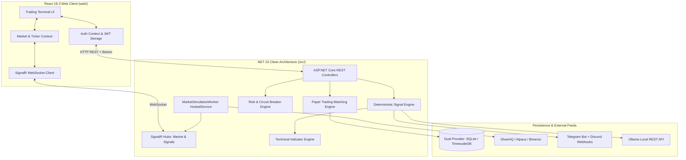
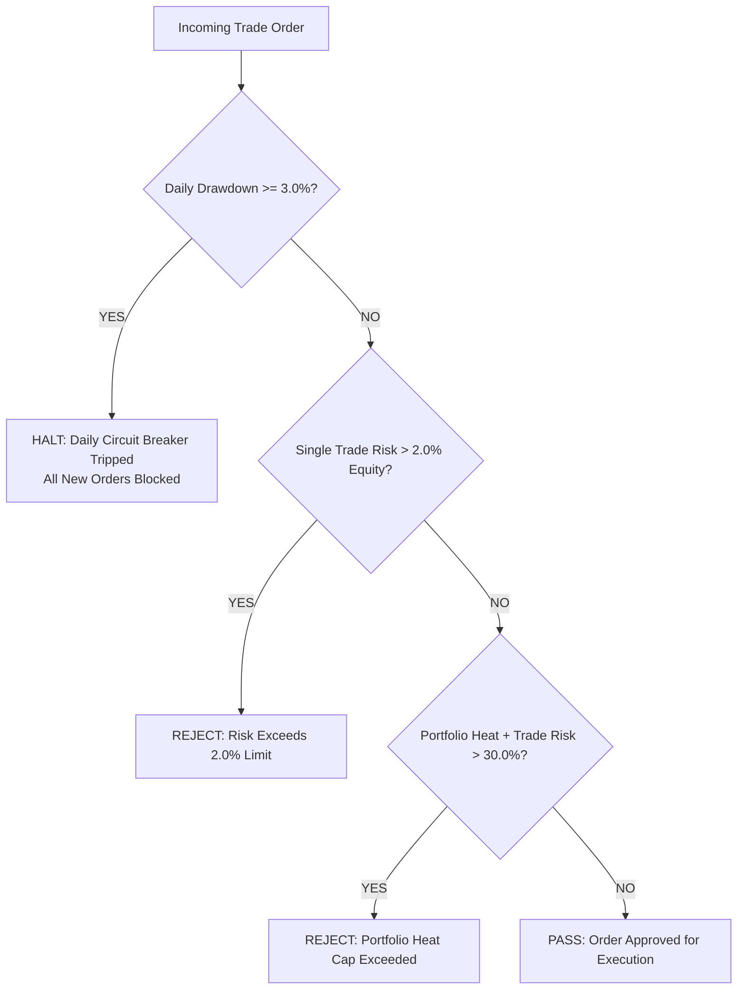

# ProStock — Institutional Algorithmic Trading & Quantitative Terminal

[](#)
[-purple.svg)](#)
[](#)
[](#)
[-red.svg)](#)
[](#)

> **ProStock** is an institutional-grade, multi-asset algorithmic trading terminal and real-money quantitative risk management system. It unifies deterministic mathematical signal generation, multi-timeframe indicator analytics, virtual order book matching with transaction tax deductions, automated trailing stops, and non-negotiable capital preservation circuit breakers across **Indian Equities (NSE)**, **US Equities (NASDAQ/NYSE)**, and **Crypto (Binance)**.

---

## 📌 Table of Contents
1. [Where Git Lives & Git Setup](#1-where-git-lives--git-setup)
2. [Platform Architecture & Directory Structure](#2-platform-architecture--directory-structure)
3. [System Prerequisites](#3-system-prerequisites)
4. [Quick Start: From Clone to Live Terminal](#4-quick-start-from-clone-to-live-terminal)
5. [Authentication & Default Credentials](#5-authentication--default-credentials)
6. [Complete Understanding of the Web Terminal](#6-complete-understanding-of-the-web-terminal)
7. [Real-Money Capital Preservation Guardrails](#7-real-money-capital-preservation-guardrails)
8. [Configuring API Keys & Live Brokers (.env)](#8-configuring-api-keys--live-brokers-env)
9. [Running Tests & Verifying Compilation](#9-running-tests--verifying-compilation)
10. [Troubleshooting & FAQ](#10-troubleshooting--faq)

---

## 1. Where Git Lives & Git Setup

### 📍 Where should Git be placed?
Git **MUST be initialized directly in the root folder** of the project (`ProStock/`):

```
c:\Users\...\Desktop\ProStock\  <--- YOU INITIALIZE GIT HERE! (Root directory)
│
├── .git/                      <--- Hidden Git tracking directory created here
├── .gitignore                 <--- Master ignore file protects .env, bin, node_modules
├── .env                       <--- Your private API keys (IGNORED BY GIT)
├── .env.example               <--- Tracked template for other developers
├── README.md                  <--- This master guide
├── ProStock.slnx              <--- .NET Solution file
├── run_backend.bat            <--- 1-click backend runner
├── run_web.bat                <--- 1-click frontend runner
├── src/                       <--- Backend Clean Architecture projects
├── tests/                     <--- Automated unit test suite
└── web/                       <--- React Vite frontend terminal
```

### 🚀 Initial Git Push Commands
Open your terminal (PowerShell, Command Prompt, or Git Bash) in the **root `ProStock` folder**:

```bash
# Step 1: Initialize Git in the root folder
git init

# Step 2: Add all files (.gitignore automatically excludes .env, node_modules, and bin/obj)
git add .

# Step 3: Verify staged files (ensure .env and node_modules are NOT listed)
git status

# Step 4: Commit your baseline repository
git commit -m "feat: complete ProStock institutional trading platform (.NET 10 + React 18 + SignalR)"

# Step 5: Rename default branch to main
git branch -M main

# Step 6: Link to your remote GitHub / GitLab repo and push
git remote add origin https://github.com/<your-username>/<your-repo-name>.git
git push -u origin main
```

---

## 2. Platform Architecture & Directory Structure



### Directory Anatomy
- **`src/ProStock.Domain/`**: Pure enterprise business rules. Contains entities (`User`, `Instrument`, `Candle`, `Signal`, `PaperAccount`, `PaperPosition`, `PaperOrder`) and core enums without external dependencies.
- **`src/ProStock.Application/`**: Service contracts, DTOs, CQRS engine abstractions, and database interfaces (`IApplicationDbContext`, `IRiskEngine`, `ISignalEngine`, `IPaperBroker`).
- **`src/ProStock.Infrastructure/`**: Mathematical engines (Wilder's RSI, EMA, SuperTrend, VWAP, RVOL), PBKDF2 password hasher, HS256 JWT token generator, EF Core database mappings, automated database seeder, and Telegram/Discord dispatchers.
- **`src/ProStock.Api/`**: REST API endpoints, SignalR hubs (`/hubs/market`, `/hubs/signals`), background tick simulation service (`MarketSimulationWorker`), CORS, and OpenAPI documentation.
- **`tests/ProStock.UnitTests/`**: Complete xUnit test suite for indicator math, risk management bounds, and security hashing.
- **`web/`**: Institutional React 18 trading terminal built with Vite, TypeScript, and high-density dark-mode CSS tokens.

---

## 3. System Prerequisites

Ensure you have the following installed on your machine before running:

| Requirement | Minimum Version | Download Link | Purpose |
| :--- | :--- | :--- | :--- |
| **.NET SDK** | `.NET 10.0` or `.NET 9.0` | [dotnet.microsoft.com](https://dotnet.microsoft.com/download) | Compiles and runs the backend API and mathematical engines. |
| **Node.js** | `v18.0.0+` (LTS recommended) | [nodejs.org](https://nodejs.org/) | Runs the frontend Vite development server. |
| **Git** | `v2.30+` | [git-scm.com](https://git-scm.com/) | Version control and code synchronization. |
| **Ollama** *(Optional)* | Latest | [ollama.com](https://ollama.com/) | Local AI strategy explanations (e.g., `deepseek-r1:8b`). |

---

## 4. Quick Start: From Clone to Live Terminal

### Method A: The 1-Click Launchers (Easiest & Recommended)
Once you clone the repository:

1. **Copy the Environment Template**:
   ```cmd
   copy .env.example .env
   ```
2. **Start the Backend API**:
   Double-click `run_backend.bat` (or run in cmd):
   ```cmd
   run_backend.bat
   ```
   *The backend builds, auto-migrates SQLite, pre-seeds admin credentials and market data, and listens at `http://localhost:5000`.*

3. **Start the Frontend Web Terminal**:
   Double-click `run_web.bat` (or run in a second cmd window):
   ```cmd
   run_web.bat
   ```
   *Installs node modules if missing and launches Vite on `http://localhost:3000`.*

4. Open your browser and navigate to: **`http://localhost:3000`**

---

### Method B: Manual CLI Commands

#### 1. Setup Backend (.NET 10 API)
```bash
# Navigate to the API folder
cd src/ProStock.Api

# Restore and run the API
dotnet run
```
*API is live at `http://localhost:5000` (OpenAPI docs at `http://localhost:5000/openapi/v1.json`).*

#### 2. Setup Frontend (React / Vite)
```bash
# Open a new terminal and navigate to the web directory
cd web

# Install dependencies (only required on first setup)
npm install

# Start Vite dev server
npm run dev
```
*Terminal interface is live at `http://localhost:3000`.*

---

## 5. Authentication & Default Credentials

The platform is pre-seeded with institutional roles (`Admin`, `Trader`, `RiskOfficer`, `Auditor`).

### Default Administrator Account
- **Email**: `admin@prostock.local`
- **Password**: `AdminProStockPassword2026!`
- **Role**: `Admin` (*Lead Quant Admin*)

### How to Sign In:
1. Open `http://localhost:3000`.
2. Click the **"Sign In"** button on the top-right navigation bar.
3. Click the convenient **"Fill Admin Credentials"** quick-button (or type the credentials above).
4. Click **"Sign In to Terminal"**.
5. Your user initials (`LQ`) and **ADMIN** badge will appear in the top-right corner. All protected trading features and scanner triggers are now unlocked.

---

## 6. Complete Understanding of the Web Terminal

The ProStock terminal is engineered for high information density, mimicking Tier-1 quantitative trading desks (Bloomberg / TradingView):

```
┌────────────────────────────────────────────────────────────────────────────────────────┐
│ TOP NAV: ProStock [LIVE TICKER TAPE] [REGIME: BULL] [EQUITY: ₹1,000,000] [USER: ADMIN] │
├────────────────────────────────────────────────────────────────────────────────────────┤
│ TAB NAVIGATION: [Overview] [Signals] [Terminal Chart] [Portfolio] [Risk] [Backtest]   │
├───────────────────────────────────┬────────────────────────────────────────────────────┤
│                                   │                                                    │
│  MAIN INTERACTIVE PANEL           │  ANALYTICAL SIDEBAR / DOCK                         │
│  - Multi-Timeframe Candlestick    │  - 5-Factor Score Waterfall Card (0-100)           │
│  - Sector Heatmap (IT, Bank, Auto)│  - Elimination Gates Audit Log                     │
│  - Active Orders & Positions Book │  - Dynamic Trade Plan (Entry, SL, TP1, TP2, TP3)   │
│  - Real-time PnL & R-Multiples    │  - AI Quantitative Explanation Panel               │
│                                   │                                                    │
└───────────────────────────────────┴────────────────────────────────────────────────────┘
```

### Detailed Screen Breakdown:

#### 1. Overview Dashboard
- **Live Index Tickers**: Real-time quotes for Nifty 50, Bank Nifty, S&P 500, Apple, and Bitcoin.
- **Sector Heatmap**: Tracks institutional sector rotation across Nifty IT, Nifty Bank, Nifty Auto, Nifty Pharma, and Nifty FMCG.
- **Advance / Decline Breadth**: Real-time ratio of advancing vs declining stocks with new 52-week high/low telemetry.
- **Global Sessions Clock**: Synchronized clocks for Tokyo, London, New York, and Mumbai market sessions.

#### 2. Quantitative Signal Scanner
- **Deterministic 5-Factor Waterfall**: Scores setups from 0 to 100 based on:
  1. *Trend Alignment*: 20 & 50 EMA Stack slope and alignment.
  2. *Mean Reversion / Support*: VWAP absorption and bounce detection.
  3. *Volume Validation*: Relative Volume (RVOL) $> 1.2\times$ confirmation.
  4. *Volatility State*: ATR expansion/compression regime alignment.
  5. *Macro Regime*: Market-wide regime filter (`TrendingBull`, `TrendingBear`, `Ranging`).
- **5 Hard Elimination Gates**: Setups are discarded if spread exceeds limit, news blackout events are active, or portfolio heat exceeds 30%.
- **Cryptographic Audit Fingerprint**: Every signal displays a unique **SHA-256 hash** generated over its price, timestamp, and factors to prevent retrospective tampering.

#### 3. Interactive Charting Terminal
- **Multi-Timeframe OHLCV Candlesticks**: Smooth 15m, 1h, 4h, and 1D bar charts.
- **Technical Overlays**: Toggle 20/50 EMA stack, session VWAP, SuperTrend, and volume profile on/off with one click.

#### 4. Paper Trading & Portfolio Management
- **Virtual Order Book**: Place simulated Limit and Market orders with realistic simulated slippage.
- **Statutory Charges Calculation**: Automatically deducts Indian STT, exchange fees, and GST on every trade to reflect true net profitability.
- **Trailing Stop Automation**: Automatically adjusts Stop Loss to Breakeven once Take-Profit 1 (TP1) is achieved.

#### 5. Risk & Guardrails Control Center
- **Portfolio Heat Meter**: Enforces a strict 30% ceiling on aggregate open risk across all positions.
- **Single Trade Risk Gauge**: Enforces a 2% capital risk ceiling per trade.
- **Daily Drawdown Circuit Breaker**: Live monitoring of daily drawdown against the -3% kill-switch limit.

#### 6. Backtesting Lab & Strategy Telemetry
- **Institutional Metrics**: CAGR (%), Max Drawdown (%), Sharpe Ratio, Sortino Ratio, Profit Factor, and Expectancy R.
- **Interactive Cumulative Equity Curve**: Compares strategy performance against benchmark buy-and-hold returns.
- **Monthly Heatmap Matrix**: Historical monthly return percentages across years.

#### 7. Macro Intelligence & News Sentiment
- **Central Bank Calendar**: Scheduled high-impact macro announcements (RBI Repo Rate, US FOMC, US Non-Farm Payrolls, CPI).
- **News Sentiment Stream**: Aggregated financial headlines parsed with sentiment indicators (`BULLISH`, `BEARISH`, `NEUTRAL`).

---

## 7. Real-Money Capital Preservation Guardrails

Because real money is at stake, the platform enforces **three non-negotiable risk rules at the backend engine level**. These rules cannot be bypassed from the UI:



1. **Max 2.0% Single Trade Risk**:
   $$\text{Dollar Risk} = |\text{Entry Price} - \text{Stop Loss}| \times \text{Quantity} \le \text{Total Equity} \times 0.02$$
   *Any order risking more than 2% of capital is rejected with HTTP 400.*
2. **Max 30.0% Aggregate Portfolio Heat**:
   $$\text{Portfolio Heat} = \frac{\sum \text{Open Dollar Risk}}{\text{Total Equity}} \times 100 \le 30.0\%$$
   *Prevents over-leveraging across correlated assets.*
3. **Hard 3.0% Daily Drawdown Circuit Breaker**:
   *If account equity drops 3.0% below the day's baseline, the system enters `HALTED` state, immediately cancels open orders, and blocks new trades until an Administrator resets the lock.*

---

## 8. Configuring API Keys & Live Brokers (.env)

All configuration is centralized in the root [`.env`](file:///.env) file. Use [`.env.example`](file:///.env.example) as reference:

```ini
# ==============================================================================
# PROSTOCK MASTER CONFIGURATION
# ==============================================================================

# Database Provider: 'Sqlite' for zero-config local, 'PostgreSql' for TimescaleDB
PROSTOCK_DATABASE_PROVIDER=Sqlite
PROSTOCK_DB_CONNECTION_STRING=Data Source=prostock_local.db

# JWT Institutional Signing Secret (Minimum 32 characters)
PROSTOCK_JWT_SECRET=ProStock_Super_Secure_Institutional_JWT_Secret_Key_2026_AtLeast32BytesLong!

# DhanHQ (India Equities & F&O)
DHAN_CLIENT_ID=your_dhan_client_id_here
DHAN_ACCESS_TOKEN=your_dhan_access_token_here

# Alpaca Markets (US Equities)
ALPACA_API_KEY=your_alpaca_key_id_here
ALPACA_SECRET_KEY=your_alpaca_secret_key_here
ALPACA_ENVIRONMENT=PAPER

# Binance (Crypto Spot & Futures)
BINANCE_API_KEY=your_binance_api_key_here
BINANCE_SECRET_KEY=your_binance_secret_key_here

# Mobile & Desktop Push Notifications
TELEGRAM_BOT_TOKEN=your_telegram_bot_token_here
TELEGRAM_CHAT_ID=your_telegram_chat_id_here
DISCORD_WEBHOOK_URL=your_discord_webhook_url_here

# Local AI Strategy Explainer
OLLAMA_API_BASE_URL=http://localhost:11434
OLLAMA_MODEL=deepseek-r1:8b
```

---

## 9. Running Tests & Verifying Compilation

The platform includes comprehensive automated test suites to ensure zero regressions:

### 1. Run Backend Unit Tests (.NET 10)
```bash
dotnet test ProStock.slnx
```
*Executes all 8 institutional tests covering indicator math (SMA, EMA, Wilder's RSI), risk gate rejections, circuit breaker halts, and PBKDF2/JWT security.*

### 2. Run Backend Build
```bash
dotnet build ProStock.slnx
```
*Builds all 5 solution assemblies with 0 warnings and 0 errors.*

### 3. Verify Frontend TypeScript & Production Build
```bash
cd web
npx tsc --noEmit
npm run build
```
*Compiles the frontend bundle into `/web/dist/` with zero TypeScript errors.*

---

## 10. Troubleshooting & FAQ

### Q: Port 5000 or Port 3000 is already in use
- **Backend Port (5000)**: Edit `src/ProStock.Api/Properties/launchSettings.json` and change `"applicationUrl": "http://localhost:5000"`.
- **Frontend Port (3000)**: Edit `web/vite.config.ts` and change `server: { port: 3000 }`.

### Q: How do I switch to PostgreSQL in production?
In `.env`, update:
```ini
PROSTOCK_DATABASE_PROVIDER=PostgreSql
PROSTOCK_DB_CONNECTION_STRING=Host=localhost;Database=prostock_prod;Username=postgres;Password=your_password
```
The EF Core seeder will automatically create all tables and apply migrations on first boot.

### Q: Can I run without live broker API keys?
**Yes!** The platform boots by default into **Institutional Simulation Mode**. The background worker (`MarketSimulationWorker`) continuously streams realistic market ticks over SignalR, allowing you to test strategies, paper trades, and risk gates without spending real money.

---

### 🛡️ Safety Disclaimer
*Algorithmic trading involves substantial risk of loss. Always validate strategies in Paper Trading mode and verify circuit breaker parameters before deploying real capital.*
