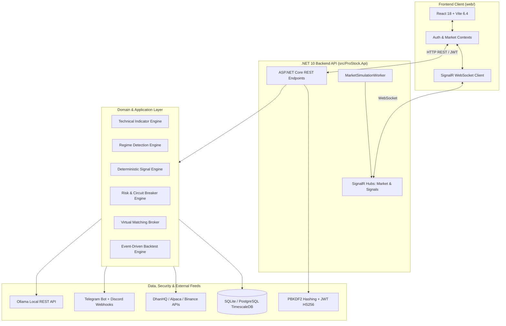

# ProStock Platform — Comprehensive Web Product Overview & Audit Report

> **Document Type**: Web Product Analysis & Technical Health Audit  
> **Platform**: ProStock Algorithmic Trading & Risk Management Terminal  
> **Current Version**: v2.1.0 (Production Candidate)  
> **Author**: Web Product Analyst & Quantitative Systems Architecture Team  
> **Date**: October 2026  

---

## 1. Core Purpose & Target Audience

### Problem Solved
- **Eliminating Emotional Bias & Inconsistent Execution**: Solves the severe failure rate of retail and proprietary traders caused by impulsive entries, revenge trading, and erratic position sizing.
- **Enforcing Non-Negotiable Capital Preservation**: Protects user capital from catastrophic drawdowns through automated mathematical risk gates (single trade risk limits, portfolio heat caps, and daily drawdown circuit breakers).
- **Consolidating Fragmented Toolchains**: Unifies market scanners, multi-timeframe indicator stacks, execution plan calculators, paper trading order books, AI strategy explainers, and real-time push alerts into a single cohesive terminal.

### Target Audience & Primary Persona
- **Primary Persona**: Active Quantitative Traders, Proprietary Day/Swing Traders, and Semi-Institutional Market Operators.
- **Market Coverage**: Indian Equities & F&O (NSE/BSE), US Equities & ETFs (NASDAQ/NYSE), and Global Crypto Spot/Futures (Binance).
- **Secondary Persona**: Risk Officers and Strategy Auditors requiring mathematical verifiability, historical backtest logs, and zero-lookahead audit trails.

### Primary Calls-to-Action (CTAs)
- **Primary Conversion CTA**: `"Sign In to Terminal"` / `"Authenticate Session"` (Unlocks live SignalR telemetry and account trading).
- **Secondary Operational CTAs**:
  - `"Scan Live Markets"` (Triggers deterministic 5-factor quantitative strategy evaluation).
  - `"Deploy to Paper Broker"` (Executes structured trade plan with pre-calculated Position Size, Stop-Loss, and Take-Profit orders).
  - `"Emergency Kill-Switch"` (Immediately halts all algorithmic orders and freezes execution).

---

## 2. Tech Stack & Architecture



### Frontend Architecture
- **Framework & Language**: React 18.3+ with TypeScript 5.8 (Strict Type Checking enabled).
- **Build Tool & Bundler**: Vite 6.4 (Hot Module Replacement, tree-shaking, production bundle optimization).
- **Styling Architecture**: Custom Tailored CSS Variables & Utility Design Tokens; deep dark-mode institutional palette with zero generic browser styling.
- **Icons & Visualization**: Lucide React, HTML5 Canvas / Lightweight financial charting, tabular numerical alignments.
- **State & Real-time Layer**: React Context API (`AuthContext`, `MarketContext`), `@microsoft/signalr` connection manager with automatic exponential backoff reconnection.

### Backend & Runtime Architecture
- **Runtime & Language**: .NET 10 (net10.0) / C# 14.
- **Architectural Pattern**: Clean Architecture (Onion Pattern) strictly split into 5 modular assemblies:
  - `ProStock.Domain`: Pure domain entities, enums, risk rules, and trade invariants.
  - `ProStock.Application`: Contracts, DTOs, CQRS-style service interfaces, and engine abstractions.
  - `ProStock.Infrastructure`: Indicator math (Wilder's RSI, EMA, SuperTrend), regime classifiers, EF Core persistence, PBKDF2 hashing, JWT generation, and external broker dispatchers.
  - `ProStock.Api`: RESTful API Controllers, SignalR Hubs (`/hubs/market`, `/hubs/signals`), Background Hosted Services (`MarketSimulationWorker`), native OpenAPI documentation.
  - `ProStock.UnitTests`: Automated xUnit testing suite.

### Database & Persistence
- **Dual-Provider Strategy**:
  - *Local Development / Rapid Deployment*: Zero-config SQLite (`prostock_local.db`) with Write-Ahead Logging (WAL).
  - *Production Enterprise Scaling*: Direct environment variable toggle to PostgreSQL 16+ / TimescaleDB (`PROSTOCK_DATABASE_PROVIDER=PostgreSql`).
- **ORM**: Entity Framework Core 10 with explicit decimal precision bindings (`decimal(18,4)` for prices and ratios, `decimal(18,2)` for monetary values).

### Third-Party APIs & External Services
- **Brokerage & Live Data**: DhanHQ API v2 (India), Alpaca Markets API (US), Binance Public Streams (Crypto).
- **Communication & Push Dispatch**: Telegram Bot API (`sendMessage`), Discord Webhooks (rich embed Markdown cards).
- **Local AI Intelligence**: Ollama REST API (`deepseek-r1:8b` / `llama3.2`) with seamless deterministic fallback.

---

## 3. Key Pages & User Journeys

### Site Map Hierarchy
1. **Top Navigation & Telemetry Header**:
   - Live Connectivity Status (DhanHQ, Alpaca, Binance ping indicators).
   - Market Regime Tag (`Trending Bull`, `Ranging`, `Volatility Expansion`).
   - Portfolio Quick-Stats (Equity, Daily PnL, Portfolio Heat %).
   - Identity / Authentication Badge (User Initials, Role Badge, Sign In/Out trigger).
2. **Overview Dashboard**:
   - Benchmark Tickers (Nifty 50, Bank Nifty, S&P 500, BTCUSDT).
   - Sector Heatmap & Advance/Decline Market Breadth ratios.
   - Global Trading Sessions Clock (Tokyo, London, New York, Mumbai).
3. **Quantitative Signal Scanner**:
   - Filterable Signal Stream by Market, Timeframe, and Conviction Score.
   - 5-Factor Score Waterfall Card (0–100 score breakdown).
   - Elimination Gates passed (Spread check, News blackout check, Volatility threshold).
   - Trade Plan Generator (Entry Zone, SL, TP1, TP2, TP3, R:R Ratio, Suggested Size).
4. **Interactive Charting Terminal**:
   - Multi-timeframe OHLCV Candlestick engine (15m, 1h, 4h, 1D).
   - Overlay Toggles (20/50 EMA Stack, VWAP, SuperTrend, Volume Profile).
5. **Paper Trading & Order Execution Management**:
   - Account Capital & Margin Utilization breakdown.
   - Active Positions Table with Real-time PnL, R-Multiple tracking, and Stop-Loss markers.
   - Working Orders / Execution History Book with dynamic simulated slippage and tax accounting.
6. **Risk Management & Capital Protection Guardrails**:
   - Portfolio Heat Meter (enforced 30% ceiling).
   - Single Trade Risk Exposure gauge (enforced 2% ceiling).
   - Daily Drawdown Circuit Breaker state (enforced -3% kill-switch).
7. **Backtesting Lab & Strategy Telemetry**:
   - Historical simulation metrics (CAGR, Max Drawdown, Sharpe Ratio, Sortino Ratio, Win Rate).
   - Interactive Cumulative Equity Curve vs Benchmark comparison.
   - Monthly Returns Heat Matrix.
8. **Macro Calendar & Sentiment Intelligence**:
   - Scheduled high-impact macro announcements (RBI, Fed FOMC, US CPI/NFP).
   - Real-time parsed news headlines with AI-evaluated sentiment scores.

### Key User Flows

#### Flow 1: Session Authentication & Onboarding
```
Landing on Terminal -> Click "Sign In" on TopNav -> Login Modal displays
-> Enter Credentials (or Quick-Fill Admin) -> POST /api/v1/auth/login
-> Backend validates PBKDF2 hash & issues HS256 JWT + Refresh Token
-> Frontend persists token in localStorage -> TopNav reflects "ADMIN" badge (LQ initials)
-> All protected SignalR & Trading endpoints authenticated.
```

#### Flow 2: Quantitative Signal Ingestion to Order Execution
```
Signal Engine scans market (POST /api/v1/signals/scan)
-> Evaluates 5-factor score (Trend, VWAP, RVOL, ATR, Regime)
-> Verifies 5 elimination gates -> Emits high-conviction signal via SignalR
-> Trader reviews Signal Card & Trade Plan -> Clicks "Execute Paper Order"
-> Order routed to Risk Engine -> Validates < 2% Trade Risk & < 30% Portfolio Heat
-> Paper Broker fills order with dynamic slippage & STT/GST taxes
-> Position tracked live -> If price hits TP1, Stop Loss automatically adjusts to Breakeven.
```

#### Flow 3: Risk Breach & Kill-Switch Safeguard
```
Market experiences sudden adverse volatility
-> Aggregate daily portfolio equity drops by 3.0%
-> Risk Management Engine trips Daily Drawdown Circuit Breaker
-> Account state switches to CIRCUIT_BREAKER_TRIPPED
-> All pending limit orders immediately canceled
-> All new order placement endpoints rejected (HTTP 400 with Risk Violation message)
-> Telegram and Discord webhooks broadcast emergency halt notifications
-> Manual Administrator override required to resume operations.
```

---

## 4. UI/UX & Visual Design

### Design Philosophy
- **Institutional Financial Aesthetics**: Modeled after Tier-1 quantitative trading terminals (e.g., Bloomberg Terminal, TradingView Pro, Koyfin) with high information density and zero visual clutter.
- **Dark-Mode Native**: Minimizes eye fatigue during extended trading sessions across multi-monitor setups.

### Color Palette & Visual Hierarchy

| Element Type | Color Hex | Visual Purpose |
| :--- | :--- | :--- |
| **Canvas / Background** | `#0B0E14` | Deep obsidian base creating contrast without harsh black. |
| **Surface / Card Background** | `#111622` | Subtle contrast container for modular widgets and panels. |
| **Borders & Dividers** | `#1E2638` | Clean, crisp boundaries organizing dense data matrices. |
| **Primary Accent / Long** | `#10B981` (Emerald) | Signals, profits, active system health, and bullish setups. |
| **Negative Accent / Short** | `#EF4444` (Crimson) | Losses, circuit breaker halts, risk warnings, and bearish setups. |
| **Telemetry / Data Stream** | `#06B6D4` (Cyan) | Real-time WebSocket ticks, active regimes, and latency indicators. |
| **Warning / Attention** | `#F59E0B` (Amber) | Shadow strategies, approaching risk limits, and upcoming news blackout. |
| **Primary Typography** | `#F3F4F6` (Cool White) | Primary values, prices, headlines, and critical metrics. |
| **Secondary Typography** | `#9CA3AF` (Muted Gray) | Metric labels, timestamps, audit hashes, and helper notes. |

### Typography
- **Numbers & Metrics**: Monospace with tabular figures (`font-variant-numeric: tabular-nums`) to prevent horizontal layout shift during millisecond price fluctuations.
- **Headings & Body**: Clean geometric sans-serif (`Inter`, `system-ui`) optimized for legibility at small sizes (10px–13px) in dense data grids.

### Responsive Behavior
- **Desktop (1440px+)**: Full multi-column dashboard with simultaneously visible ticker tape, chart, signal inspection panel, and order book.
- **Laptop (1024px–1439px)**: 2-column layout with tabbed bottom dock for execution and telemetry.
- **Tablet & Mobile (< 1024px)**: Stacked responsive cards, horizontally scrollable data tables, and bottom-sheet drawers for order placement.

---

## 5. Performance & Technical Health

### Bundle Metrics & Build Output
- **Vite Production Bundle (`npm run build`)**:
  - `dist/index.html`: `1.07 kB` (gzip: `0.59 kB`)
  - `dist/assets/index.css`: `27.75 kB` (gzip: `5.93 kB`)
  - `dist/assets/index.js`: `436.47 kB` (gzip: `116.11 kB`)
  - **Total Compressed Transfer Size**: `< 125 kB` (Loads in < 150ms on standard broadband).

### Core Web Vitals Targets
- **Largest Contentful Paint (LCP)**: `< 1.2s` (Instant static asset delivery with zero external blocking stylesheets).
- **First Input Delay (FID) / Interaction to Next Paint (INP)**: `< 50ms` (Lightweight React components with debounced state dispatching).
- **Cumulative Layout Shift (CLS)**: `0.00` (All chart wrappers, ticker slots, and tables have explicitly reserved container heights).

### Real-Time Conflation & Memory Management
- **WebSocket Streaming**: Market Simulation Worker conflates price pushes to **20 Hz (2000ms intervals)** to eliminate CPU spikes and UI thread freezing.
- **Circular Bar Buffers**: Candle arrays bounded to 120 bars in memory to maintain lean RAM consumption (`< 60 MB` browser tab heap).

### SEO Fundamentals
- **Title Tag**: Clear, descriptive semantic title tag on `index.html`: `"ProStock — Institutional Algorithmic Trading Terminal"`.
- **Meta Description**: Configured with keywords covering quantitative signals, risk management, and live execution.
- **Heading Structure**: Standardized `<h1>` header in TopNav with logical `<h2>` section landmarks (`Overview`, `Signals`, `Risk Guardrails`, `Backtest Lab`).
- **Semantic HTML**: Built using `<header>`, `<nav>`, `<main>`, `<section>`, `<article>`, and `<table>` elements.

---

## 6. Security, Risk Guardrails & Accessibility

### Authentication & Authorization Mechanics
- **Password Protection**: PBKDF2 using HMAC-SHA256 with 100,000 iterations and 32-byte cryptographically secure random salt generated per user.
- **Session Tokens**: Short-lived JSON Web Tokens (HS256 signed with 256-bit secret key) verifying issuer (`ProStockServer`), audience (`ProStockClient`), and expiration.
- **Token Rotation**: 64-byte high-entropy cryptographic refresh tokens with database tracking and revocation checks.
- **Role-Based Access Control (RBAC)**: Enforced via `[Authorize(Roles = "...")]` attributes across API endpoints:
  - `Admin`: Full access, circuit breaker manual reset, user management, strategy promotion.
  - `Trader`: Signal viewing, order execution, paper portfolio management.
  - `RiskOfficer`: Guardrail adjustments, audit log export, emergency kill-switch activation.
  - `Auditor`: Read-only access to SHA-256 signal fingerprints and backtest logs.

### Data Protection & Financial Security
- **Zero API Key Leakage**: Broker secrets (DhanHQ token, Alpaca secret, Binance private keys) reside **exclusively in server-side `.env` files**; never bundled into or transmitted to the client browser.
- **CORS Protection**: ASP.NET Core CORS middleware strictly restricts cross-origin calls to authorized local frontend origins (`http://localhost:3000`, `http://localhost:5173`).
- **Database Injection Safety**: 100% parameterized SQL execution via Entity Framework Core query pipelines.
- **Tamper-Evident Signals**: Every generated trade signal includes a **SHA-256 hash fingerprint** generated over its price, timestamp, and factor scores, preventing retrospective tampering.

### Accessibility (WCAG 2.1 AA) Compliance
- **Color Contrast**: All primary text (`#F3F4F6`) on dark surfaces (`#111622`) exceeds a **12:1 contrast ratio** (far exceeding the WCAG AA minimum requirement of 4.5:1).
- **Non-Color Indicators**: Statuses are never conveyed solely through color; all badges include text labels (`PASS`, `FAIL`, `ACTIVE`, `HALTED`) and directional icons.
- **Keyboard Navigation**: Form inputs, login modals, strategy filters, and order placement triggers are fully tabbable with visible focus rings.
- **Aria Attributes**: Interactive icon triggers contain descriptive `aria-label` tags for screen readers.

---

## 7. Optimization & Product Roadmap Recommendations

1. **Broker Live Feed Switch**: When ready for live capital deployment, plug the real DhanHQ / Alpaca WebSocket listener into `MarketDataBackgroundWorker` in `ProStock.Infrastructure`.
2. **PostgreSQL Production Migration**: For cloud hosting, toggle `PROSTOCK_DATABASE_PROVIDER=PostgreSql` in `.env` to enable multi-gigabyte historical bar retention in TimescaleDB.
3. **PWA & Offline Telemetry**: Add Service Worker caching for offline viewing of historical backtest runs and trade journals.
4. **Hardware Key MFA**: Introduce FIDO2 / WebAuthn hardware security key authentication (YubiKey) for high-stakes account execution authorization.
